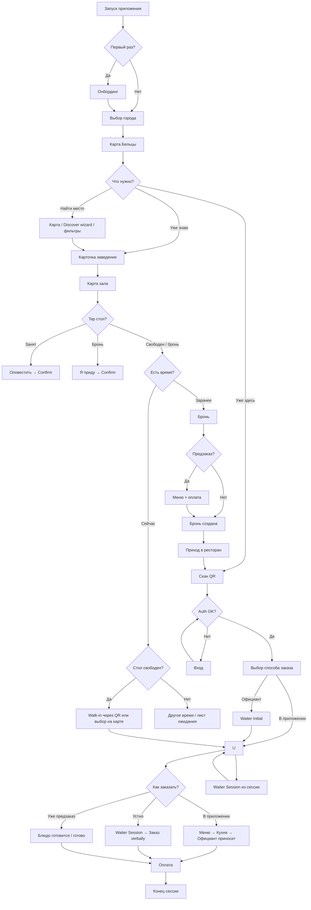

# Seatiko — логика приложения

Документ описывает полный путь пользователя — от первого входа до целевого действия (бронь, заказ, вызов официанта), а также логику для персонала и ресторанов.

> Связанные документы: [README](./README.md) · [I18N](./I18N.md) · [UX Screens](./UX_SCREENS.md) · [Changelog](./CHANGELOG.md) · [Диаграммы](./diagrams/) · [Прототип](./prototype/)

---

## 1. Контекст и принятые решения

| Параметр | Решение |
|----------|---------|
| **Название** | **Seatiko** (от англ. *seat* — место за столом; читается «Сеатико» / «Sea-ti-co»). Код: папка `seatiko/`, Go-модуль `github.com/seatiko/api`, Android `com.seatiko.mobile`, демо-аккаунты `@seatiko.local` |
| **Языки** | RU / EN / RO — см. [I18N.md](./I18N.md) |
| Платформа | Мобильное приложение (iOS/Android) + веб, единый backend |
| География MVP | **Бельцы, Молдова** (пилот) |
| Авторизация | Обязательна для бронирования и заказа; просмотр карты/меню — без регистрации |
| Оплата | В приложении (карта, Apple Pay, Google Pay) **или** в заведении |
| QR + бронь | Оба режима: walk-in через QR (если стол свободен) и подтверждение забронированного столика |
| Персонал | Веб-панель ресторана + мобильное приложение для официантов |
| Подбор мест | Web: мастер предпочтений `/discover` → карта с фильтром/рангом; цель: фильтры + AI-чат + сезонные подборки |
| Подключение ресторанов | **Рекомендация:** гибрид — заявка → модерация → самостоятельная настройка зала, меню, QR |

---

## 2. Роли и приложения

```
┌─────────────────────────────────────────────────────────────────┐
│                        ПЛАТФОРМА                                 │
├──────────────┬──────────────┬──────────────┬────────────────────┤
│ Клиент       │ Официант     │ Админ зала   │ Платформа          │
│ (mobile/web) │ (mobile)     │ (web)        │ (web, internal)    │
├──────────────┼──────────────┼──────────────┼────────────────────┤
│ Искать места │ Принимать    │ Карта зала   │ Модерация          │
│ Бронировать  │ вызовы       │ Управление   │ ресторанов         │
│ Заказывать   │ Доставлять   │ столами      │ Аналитика          │
│ Оплачивать   │ заказы       │ Меню, QR     │ Город, акции       │
│ QR на столе  │              │ Заказы       │                    │
└──────────────┴──────────────┴──────────────┴────────────────────┘
```

---

## 3. Точка входа: первый запуск

### 3.1. Splash → определение контекста

```
[Splash]
    │
    ├─► Геолокация разрешена? ──Нет──► [Запрос геолокации] ──отказ──► [Выбор города вручную]
    │         │ Да
    │         ▼
    │    [Город = Бельцы?] ──Нет──► [Экран «Скоро в вашем городе» + подписка на уведомление]
    │         │ Да
    │         ▼
    ├─► Первый запуск? ──Да──► [Онбординг 4 слайда]
    │         │                      │
    │         │                      ▼
    │         │               [Выбор города]
    │         │                      │
    │         │ Нет                  ▼
    │         ▼               [Карта Бельцы]
    └─► [Выбор города] ──► [Карта Бельцы]
```

### 3.2. Онбординг (кратко)

1. «Найди место на карте или спроси AI»
2. «Забронируй стол и закажи заранее»
3. «Пришёл — отсканируй QR, еда уже ждёт»
4. «Позови официанта одной кнопкой»

После онбординга — **страница выбора города**, затем карта. Регистрация не требуется.

### 3.3. Главный экран (Home)

**Нижняя навигация — два ряда:**

| Ряд | Элемент | Экран |
|-----|---------|-------|
| **Верхний** | 📷 **Сканируйте QR на месте** | Сканер QR |
| **Нижний** | 🗺 Карта · ✨ Подбор · 📋 Заказы · 👤 Профиль | Соответствующие вкладки |

---

## 4. Дерево решений пользователя

Пользователь попадает в одну из **5 целевых веток**:

```
                    [Главный экран]
                          │
        ┌─────────┬───────┼───────┬─────────┐
        ▼         ▼       ▼       ▼         ▼
   Найти место  Уже знаю  Уже в   Хочу      Праздник/
   (карта/AI)   заведение ресторане заказ   событие
        │         │       │       на вынос  (подборка)
        ▼         ▼       ▼       │         │
   [Карточка    [Карточка [QR]     ▼         ▼
    заведения]   заведения]         [Список   [Спец.
        │         │                 заведений подборка]
        ▼         ▼                 с takeout]
   [Карта зала] [Карта зала]
        │         │
        ▼         ▼
   [Бронь /      [Бронь /
    Предзаказ]    Предзаказ]
        │         │
        └────┬────┘
             ▼
      [В ресторане: QR → Сессия за столом]
             │
             ▼
      [Заказ / Вызов официанта / Оплата]
```

---

## 5. Детальные пользовательские сценарии

### 5.1. Сценарий A: «Найти где поесть» (карта + фильтры)

```
[Карта города]
    │ пин / список / поиск
    ▼
[Фильтры]: кухня, цена, рейтинг, расстояние, «есть свободные столы сейчас», takeout
    │
    ▼
[Карточка заведения]
    ├─ фото, рейтинг, часы работы, средний чек
    ├─ «Свободно N столиков» (live)
    ├─ [Посмотреть зал] [Забронировать] [Меню] [В избранное]
    └─ [Маршрут] (внешняя карта)
```

**Gate авторизации:** «Забронировать» → если не авторизован → [Экран входа/регистрации] → возврат на карточку.

---

### 5.2. Сценарий B: «Подбери мне место» (предпочтения → карта; AI — фаза)

#### Web v1: `/discover` (реализовано)

```
[Landing] «Найти ресторан» → [/discover]
    │
    ├─► [Stepper] 5 измерений (multi-select chips):
    │       кухня · тип заведения · бюджет · повод · практика
    │
    ├─► [Guided chat] scripted chips (без внешнего LLM)
    │       те же измерения → общее состояние DiscoverPreferences
    │
    └─► [Показать рекомендации]
            ▼
        /?cuisine=…&budget=…#map
            ▼
        [Карта] GET /api/v1/map/places
            жёсткий фильтр (AND по измерениям) + fit-score rank
            бар «Активные предпочтения» (Изменить / Сбросить)
```

**Правила (web v1):**

1. Пустое измерение = без ограничения по оси; внутри измерения — OR, между — AND.
2. Occasion — soft score (не единственная причина исключения).
3. «Только партнёры» → `in_database: true`; иначе Google-only пины тоже участвуют.
4. Фильтрация и ранжирование — **на клиенте**; новых API нет.
5. Skip / «Смотреть карту» → `/#map` без prefs.

#### Цель / mobile: AI-чат + праздничные подборки

```
[Tab «Подбор»]
    │
    ├─► [Быстрые фильтры]: «Близко», «Бюджетно», «Романтика», «С детьми», «Быстро»
    │
    ├─► [AI-чат] (LLM или keyword API)
    │       Пользователь: «Хочу острое, недалеко, до 400 лей»
    │       Система учитывает: геолокация, время суток, история, погода
    │       ▼
    │   [Список 3–7 рекомендаций с объяснением «почему»]
    │
    └─► [Сезонные подборки]: «8 марта», «Новый год», «День рождения» и т.д.
```

**Логика AI-подбора (backend, целевая):**

1. Парсинг intent: кухня, бюджет, настроение, компания, срочность.
2. Жёсткие фильтры: Бельцы, открыто сейчас (опционально), есть свободные столы.
3. Скоринг: расстояние + рейтинг + match по тегам + персональная история.
4. Ответ: топ-N + текст «Почему мы предложили это».

**Без регистрации:** до 3 AI-запросов/день → затем предложение войти.  
`POST /discover/ai` — keyword/legacy path; web wizard его не вызывает.

---

### 5.3. Сценарий C: «Забронировать стол» (+ опционально предзаказ)

**Где гость бронирует (web)** — одна форма брони и один экран подтверждения везде:

| Вход | Вопрос гостя | Что происходит |
|---|---|---|
| Каталог `/venues`, карта, кабинет («Забронировать снова», избранное), меню | «Хочу в этот ресторан» | `/venues/<id>?book=1` → страница ресторана с открытым окном быстрой брони |
| Страница ресторана | «Я выбрал ресторан» | «Быстрая бронь» (окно, любой подходящий стол) · «Выбрать стол» (схема зала → окно) · «Праздник или банкет» (окно заявки, `?book=event`) |
| `/book` «Быстрая бронь» | «Где есть стол на 19:30 на четверых?» или «Хочу в знакомый ресторан, быстро» | Поиск по всем ресторанам: гости · день · время · длительность → рестораны, где стол действительно свободен, с ближайшими временами → клик по времени открывает то же окно брони, уже заполненное. Строка поиска по названию / кухне / улице сужает список до знакомого ресторана (он показывается, даже если около выбранного времени занято: со свободным временем в этот день или кнопкой «Выбрать другой день»); рядом — «Подбор по вкусу» |

Параметры окна: `?book=1&time=<ISO>&guests=N&duration=<мин>`; после закрытия окна они убираются из адреса. Старые ссылки `/book?venue=<id>` перенаправляются туда же.
Свободное время в поиске считается по тем же правилам, что и в окне брони (шаг брони, длительность ресторана, часы работы, занятость столов). Пилот — расчёт в браузере; целевой вариант — серверный запрос (см. ENGINEERING, «Поиск свободных столов»).

```
[Карточка заведения] → [Карта зала]
    │
    ▼
[Карта зала — интерактивная]
    Столики: 🟢 свободен | 🟡 забронирован (не ваш) | 🔴 занят | 🔵 ваш (бронь/сессия)
    Tap стол → карточка:
      🔴 «Пришли в HH:MM» + «Оповестить» → Auth → Confirm → TableWatch
      🟡 «Забронирован на HH:MM» + «До брони» + правила 1ч/15мин + «Я приду» → Auth → Confirm
    │
    ▼
[Выбор столика] → [Выбор даты/времени/гостей]
    │
    ▼
[Gate: Авторизация] ──► [Подтверждение брони]
    │
    ├─► Только бронь → [Бронь создана] → push/email напоминание
    │
    └─► Бронь + предзаказ → [Меню] → [Корзина] → [Оплата или «Оплачу в ресторане»]
              │
              ▼
        [Бронь + заказ в статусе «Готовится к вашему приходу»]
```

**Правила бронирования:**

| Правило | Значение |
|---------|----------|
| Hold time | Стол держится 15 мин после времени брони; если гость заранее отметил опоздание в «Я приду» — до `expected_arrival` (не больше 30 мин после брони) |
| Отмена | Бесплатно за 2+ часа; позже — предупреждение |
| Предзаказ | Кухня получает заказ за X мин до времени брони (настраивается рестораном) |
| No-show | 3 no-show → предупреждение; возможен депозит (фаза 2) |

**Подсказка на экране подтверждения брони:** при предзаказе блюд гость видит, что еда будет на столе к приходу или подана вскоре после посадки (зависит от настройки ресторана и времени готовки).

**Карточка столика на карте зала (просмотр без брони):**

| Статус | Что видит пользователь | Действие |
|--------|------------------------|----------|
| 🟢 FREE | «Свободен» | Забронировать этот стол |
| 🔴 OCCUPIED | «Пришли в {HH:MM}» + подсказка об ориентировочном освобождении | «Оповестить» → confirm → push при FREE |
| 🟡 RESERVED | «Забронирован на {HH:MM}» + «До брони: {duration}» + правила | «Я приду» → confirm → push staff |
| 🔵 YOURS | «Ваш стол» | Переход в сессию |

**Правила посадки на забронированный стол (до времени брони):**

| Правило | Значение по умолчанию |
|---------|----------------------|
| Начало сессии | Не раньше чем за **1 ч** до `reserved_for` |
| Освобождение | Стол свободен за **15 мин** до `reserved_for` |
| Обратный отсчёт | «До брони: 45 мин» — ориентир для гостей и staff |

`occupied_since` — время фактической посадки (walk-in через QR, посадка хостесс, check-in по брони).  
`reserved_for` — запланированное время брони из приложения.

**Подписка «Оповестить когда освободится»:**

- Требует авторизации (для push-токена)
- **Confirm dialog** перед созданием подписки
- Одна подписка на стол в рамках текущей смены/дня
- Срабатывает при `OCCUPIED → FREE` (или после `CLEANING → FREE`)
- Автоотмена подписки через 3 ч или при успешном уведомлении

**«Я приду» (подтверждение брони):**

- Требует авторизации + **confirm dialog** с правилами посадки
- Push staff/hostess: «Гость подтвердил приход к {time}»
- После подтверждения — «Ждём вас к {time}» на карточке столика
- Доступно **только владельцу брони** (backend проверяет `reservation.user_id`)
- В окне: слева «Когда вы будете у стола» — выбранное время (только показ, не поле ввода); справа «Когда вы придёте?» — варианты **Сейчас / Вовремя / Опоздаю на 15 мин / Опоздаю на 20 мин**. Варианты, время которых уже прошло, неактивны.
- **Опоздание:** гость может заранее отметить приход до `venue.max_late_arrival_min` после `reserved_for` (по умолчанию **30 мин**, настраивает ресторан). Варианты «+15 / +20», выходящие за предел, неактивны. Backend отклоняет время позже предела (`409 invalid_status`).
- Отмеченное опоздание **продлевает удержание стола** до `expected_arrival` (вместо `hold_minutes`) и сдвигает занятость стола: следующая бронь возможна не раньше `expected_arrival + duration_min`.

**Длительность брони выбирает гость:** в окне брони — «Длительность» (1 ч, 1,5 ч … до `max_visit_duration_min`, шаг 30 мин; заранее выбрана `visit_duration_min`). Слоты времени пересчитываются под выбранную длительность (бронь должна закончиться до закрытия и не пересекаться с другими бронями стола). Backend сохраняет `reservation.duration_min`, проверяет диапазон (`400 invalid_duration`) и учитывает её в занятости стола и расписании.

**Правила брони ресторана (настраивает владелец):**

- Кабинет → «Зал / меню / QR» → «Правила брони»: шаг времени, длительность брони по умолчанию и максимальная, опоздание без предупреждения, максимальное опоздание с предупреждением, посадка до брони, освобождение для гостей без брони, предзаказ. API: `PATCH /restaurant/venues/:venueId/booking-rules` (диапазоны проверяются, `max_late_arrival_min ≥ hold_minutes`).
- Гость видит правила: на странице ресторана — блок «Правила бронирования» сразу под карточкой ресторана (перед схемой зала); в окне брони — раскрывающийся блок «Правила бронирования» с тем же списком и перед кнопкой подтверждения «Без предупреждения можно опоздать на {hold_minutes} мин… отметьте в «Я приду» — подождём до {max_late_arrival_min} мин» ; длительность гость выбирает сам; в «Я приду» — предел опоздания.

**Напоминание владельцу брони (за 20–25 мин до `reserved_for`):**

- Push: «Через 20 минут ваша бронь в {venue}, стол №{n}. Успеваете?» с действием «Указать время прихода».
- По нажатию открывается то же окно «Я приду» (Вовремя / Опоздаю на 15 / 20 мин). **Заполнять не обязательно:** если гость не ответил, действуют стандартные правила (hold 15 мин после брони, затем no-show).
- Отправляется один раз на бронь; не отправляется, если гость уже подтвердил приход или бронь создана меньше чем за 25 мин до начала.

**Оповещение гостям, которые сидят за столом до брони:**

- Кому: гости с активной сессией за этим столом (walk-in через QR / посадка хостесс), пока стол числится под бронью, и hostess.
- Когда: владелец брони отметил опоздание («Опоздаю на 15 / 20 мин»).
- Текст: «Гость с бронью задерживается — можете остаться за столом до {time}», где `{time} = expected_arrival − release_before_min`.
- Если гость с бронью подтвердил «Вовремя» или «Сейчас» — оповещение не отправляется (действует обычное время освобождения).
- Если опоздание отменено или гость пришёл раньше, сидящим отправляется обновлённое время освобождения.

#### Модель данных (карточка столика)

| Поле | Тип | Когда заполняется |
|------|-----|-------------------|
| `table.status` | `FREE \| RESERVED \| OCCUPIED \| CLEANING` | Realtime |
| `table.occupied_since` | `datetime` | При посадке (QR, walk-in, check-in) |
| `table.reserved_for` | `datetime` | При создании брони |
| `table.reservation_id` | `uuid?` | Если статус RESERVED |
| `venue.session_start_before_min` | `int` | Default **60** — за сколько мин до брони можно начать сессию |
| `venue.release_before_min` | `int` | Default **15** — за сколько мин до брони стол должен быть FREE |
| `venue.hold_minutes` | `int` | Default **15** — опоздание без предупреждения (стол ждёт после `reserved_for`); `0` — не ждёт |
| `venue.max_late_arrival_min` | `int` | Default **30** — максимальное опоздание, если гость отметил его в «Я приду» (не меньше `hold_minutes`) |
| `venue.visit_duration_min` | `int` | Default **90** — длительность брони, выбранная в окне брони заранее |
| `venue.max_visit_duration_min` | `int` | Default **180** — максимальная длительность, которую может выбрать гость |
| `reservation.duration_min` | `int` | Длительность, выбранная гостем при бронировании (30 … `max_visit_duration_min`); пусто — `visit_duration_min` |
| `venue.booking_interval_min` | `int` | Default **30** — шаг времени в слотах брони |
| `reservation.expected_arrival` | `datetime?` | Время прихода из «Я приду»; может быть позже брони (до +30 мин) |

**Подписка `TableWatch` (оповещение об освобождении):**

```json
{
  "user_id": "uuid",
  "venue_id": "uuid",
  "table_id": "uuid",
  "created_at": "datetime",
  "expires_at": "datetime | null"
}
```

**Подтверждение прихода `Reservation.arrival_confirmed_at`:**

- `null` — гость ещё не нажал «Я приду»
- `datetime` — подтверждено; staff видит в очереди броней

---

### 5.4. Сценарий D: «Я уже в ресторане» (QR)

QR на столе содержит: `venue_id`, `table_id`, `token` (одноразовый/ротация).

```
[Скан QR] (вкладка «Сканируйте QR на месте» в нижней панели)
    │
    ▼
[Проверки backend]
    ├─ Стол занят другой сессией? → «Стол занят, позовите официанта»
    ├─ Есть ваша бронь на этот стол? → [Подтвердить посадку] → сессия ACTIVE
    ├─ Стол свободен, брони нет? → [Walk-in: занять стол] → сессия ACTIVE
    └─ Стол забронирован другим? → «Стол ожидает других гостей»
    │
    ▼
[Gate: Авторизация] (если ещё не вошёл)
    │
    ▼
[Выбор способа заказа]
    ├─ [Заказать в приложении] → [Экран сессии] → Меню → корзина → кухня
    └─ [Позвать официанта] → [Waiter Initial] → сессия ACTIVE + push официанту
    │
    ▼
[Экран «Ваш стол №X»] — сессия за столом
    ├─ [Меню] → заказ в приложении
    ├─ [Вызов официанта] → [Waiter Session] (причина: заказ / счёт / вопрос / другое)
    ├─ [Счёт / Оплата]
    └─ [Освободить стол] (или автоматически при уходе + timeout)
```

**Два экрана вызова официанта (не путать):**

| Экран | Когда | Содержание |
|-------|-------|------------|
| **Waiter Initial** | Сразу после QR → «Позвать официанта» | Устный первый заказ, сессия создаётся автоматически |
| **Waiter Session** | Из активной сессии → «Вызов официанта» | Выбор причины + «Отправить вызов» |

**Два режима заказа за столом:**

| Режим | Поток |
|-------|-------|
| Цифровой заказ | Меню → корзина → «Отправить на кухню» → статусы блюд → официант приносит |
| Устный заказ | «Позвать официанта для заказа» → официант подходит → заказ вносит официант в staff-app (привязан к столу) |

---

### 5.5. Сценарий E: «Вызов официанта»

**Два экрана в зависимости от контекста:**

1. **Waiter Initial** (сразу после QR, выбор «Позвать официанта»):
   - Упрощённый экран: официант подойдёт принять заказ устно, сессия создаётся автоматически
   - CTA «Позвать официанта» → Session

2. **Waiter Session** (из активной сессии, кнопка «Вызов официанта»):
   - Выбор причины: Заказ / Счёт / Вопрос / Другое
   - «Отправить вызов» → push официанту → возврат на Session
   - Официант принял (staff-app) → «Иван уже идёт к вам»
   - Timeout 5 мин → эскалация админу зала
   - Повторный вызов → cooldown 2 мин

---

## 6. Состояния столика (state machine)

```
                    ┌──────────┐
                    │  FREE    │◄────────────────────────────┐
                    └────┬─────┘                              │
                         │ reserve()                          │ release()
                         ▼                                    │
                    ┌──────────┐     no-show / cancel          │
                    │ RESERVED │──────────────────────────────┤
                    └────┬─────┘                              │
                         │ check_in (QR / hostess)            │
                         ▼                                    │
                    ┌──────────┐                              │
                    │ OCCUPIED │──────────────────────────────┘
                    └────┬─────┘
                         │ cleaning (staff)
                         ▼
                    ┌──────────┐
                    │ CLEANING │──► FREE (auto after N min)
                    └──────────┘
```

**Синхронизация:** WebSocket/SSE — клиентская карта зала и staff-панель обновляются в реaltime.

---

## 7. Состояния заказа

```
DRAFT → SUBMITTED → CONFIRMED → PREPARING → READY → SERVED → PAID
                      │              │
                      └─ CANCELLED ◄─┘ (до начала готовки)
```

| Статус | Кто видит | Действие |
|--------|-----------|----------|
| DRAFT | Клиент | Редактирование корзины |
| SUBMITTED | Кухня, официант | Принять/отклонить |
| PREPARING | Клиент (прогресс) | — |
| READY | Официант | Принести к столу |
| SERVED | Клиент | «Получено» (опционально) |
| PAID | Все | Сессия может быть закрыта |

**Предзаказ к брони:** заказ создаётся заранее, переходит в PREPARING по расписанию (за N мин до времени брони).

---

## 8. Авторизация и профиль

### 8.1. Когда требуется вход

| Действие | Auth |
|----------|------|
| Просмотр карты, меню, карты зала | ❌ |
| Просмотр карточки столика (🔴/🟡) | ❌ |
| AI-подбор (>3 запросов/день) | ✅ |
| Бронирование | ✅ |
| Заказ / QR-сессия | ✅ |
| Оплата в приложении | ✅ |
| Избранное, история | ✅ |
| **Оповестить, когда стол освободится** | ✅ |
| **«Я приду» (подтверждение брони)** | ✅ |

### 8.2. Способы входа

- Телефон + SMS
- Email + пароль
- Apple / Google (social)

### 8.3. Профиль пользователя

| Поле | Редактируемое | Описание |
|------|---------------|----------|
| Имя | ✅ | `first_name` |
| Фамилия | ✅ | `last_name` |
| Как обращаться | ✅ | `display_name` — предпочитаемое обращение (официант, push, бронь) |
| Телефон | ✅ (отдельный flow) | Идентификатор аккаунта |
| Аллергии / диета | ✅ | Для AI и фильтров меню |
| Способы оплаты | ✅ | — |
| История заказов и броней | — | Только просмотр |
| Избранные заведения | ✅ | — |
| Возраст 18+ / предзаказ 18+ | ❌ read-only | Статус `adult_preorder_allowed` + кто/когда/где подтвердил (см. §8.4) |

Изменения имени / фамилии / обращения сохраняются в профиле клиента и синхронизируются с backend.

### 8.4. Возраст 18+: алкоголь и другие товары 18+

**Базовое правило:** позиции меню с ограничением возраста (**`requires_age_18: true`**) по умолчанию можно заказать **только в ресторане** — во время активной сессии за столом (QR / check-in) или через официанта. В **предзаказ к брони** такие позиции **недоступны**, пока не выполнены условия ниже.

Алкоголь — частный случай 18+: у позиции всегда `requires_age_18: true` и `contains_alcohol: true` (доп. правила лицензии и выдачи). Другие товары 18+ (если появятся в меню заведения) помечаются только `requires_age_18: true` без `contains_alcohol`.

**Исключение — предзаказ 18+ к брони:**

Клиент может добавлять в предзаказ **любые** позиции с `requires_age_18` (алкоголь и прочие 18+) **только если** одновременно:

1. Был **хотя бы в одном** заведении на платформе (завершённая сессия или check-in по брони); **и**
2. **Официант или менеджер** заведения лично подтвердил совершеннолетие гостя; **и**
3. В профиле клиента активен флаг **`adult_preorder_allowed`** (канон; устаревший синоним в коде/API: `alcohol_preorder_allowed` — то же значение).

```
[Клиент открывает меню предзаказа]
    │
    ├─ adult_preorder_allowed = false
    │       → позиции с requires_age_18 скрыты / disabled
    │       + подсказка: «Товары 18+ — после подтверждения возраста официантом»
    │       (для алкоголя можно уточнить: «Алкоголь — только в ресторане / после проверки»)
    │
    └─ adult_preorder_allowed = true
            → все requires_age_18 доступны в предзаказе к брони
            (в сессии за столом — 18+ без этого флага; при подаче — очная проверка по правилам зала/закона)
```

**Выдача разрешения (staff):**

- Кто может: **официант** или **менеджер** зала (роль в staff-app / admin)
- Где: карточка клиента за столом, очередь броней, или поиск по телефону/брони
- Действие: «Подтвердить совершеннолетие» → «Разрешить предзаказ товаров 18+» (включая алкоголь)
- **Обязательно:** staff отметил «Документ, удостоверяющий личность, предъявлен» (`id_document_checked = true`) — см. compliance ниже
- Требуется активная или недавняя сессия гостя в **этом** заведении (рекомендация MVP: check-in не старше текущего визита)

**Привязка к конкретному сотруднику (обязательно):**

- Подтверждение 18+ **не анонимное и не «общее» для заведения**: оно всегда привязано к **конкретному** `adult_verified_by_staff_id` (синоним поля: `alcohol_verified_by_staff_id`) — тому официанту/менеджеру, кто нажал grant после проверки документа.
- В профиле гостя и в audit log отображаются **кто** подтвердил, **когда** и **в каком заведении**.
- **Ответственность за ошибочное подтверждение** (гость фактически младше 18 лет, документ не проверен или проверен формально) лежит на **этом сотруднике** и на **заведении** (для алкоголя — также как на лицензиате), а не на гостевом «самоподтверждении» и не на Seatiko как на продавце.
- UI staff при grant должен явно предупреждать: действие фиксируется на **вашем** staff-аккаунте; вы подтверждаете, что лично проверили документ и гость совершеннолетний; это открывает предзаказ **всех** товаров 18+ в меню, не только алкоголя.
- Повторная выдача **алкоголя** при визите снова требует очной проверки документа; ответственность за **передачу** алкоголя в момент подачи — на сотруднике, который выдаёт заказ. Для неалкогольных 18+ — повторная проверка по политике заведения (минимум: подтверждение возраста при сомнении).

**Отзыв разрешения:**

- Менеджер / админ заведения или платформы может **забрать** `adult_preorder_allowed`
- При отзыве: все позиции с `requires_age_18` убираются из корзины предзаказа с уведомлением клиенту

#### Модель данных (клиент)

Поля на `User` / `UserProfile` (или таблица `AdultPreorderPermission`; legacy-имя `AlcoholPreorderPermission` допустимо):

| Поле | Тип | Описание |
|------|-----|----------|
| `adult_preorder_allowed` | `boolean` | Право предзаказывать **любые** позиции `requires_age_18` (алкоголь и прочие 18+) |
| `alcohol_preorder_allowed` | `boolean` | **Deprecated alias** того же флага (читать/писать как `adult_preorder_allowed`) |
| `adult_verified_at` | `datetime?` | Когда подтверждено совершеннолетие (alias: `alcohol_verified_at`) |
| `adult_verified_by_staff_id` | `uuid?` | **Обязательная привязка** к сотруднику, выдавшему разрешение (alias: `alcohol_verified_by_staff_id`) |
| `adult_verified_by_staff_role` | `waiter \| manager` | Роль выдавшего |
| `adult_verified_by_staff_display_name` | `string?` | Имя сотрудника на момент grant (снимок для аудита) |
| `adult_id_document_checked` | `boolean` | Staff подтвердил просмотр документа (обязательно для grant) |
| `adult_verified_at_venue_id` | `uuid?` | В каком заведении подтвердили |
| `adult_permission_revoked_at` | `datetime?` | Когда отозвано |
| `adult_revoked_by_staff_id` | `uuid?` | Кто отозвал |
| `has_completed_venue_visit` | `boolean` | Computed / denormalized: был ли визит в любое заведение |

**Audit (обязательно):** таблица `AdultPermissionLog` (legacy: `AlcoholPermissionLog`) — каждое grant/revoke с `staff_id`, `staff_display_name`, `venue_id`, `timestamp`, `action`, `id_document_checked`. Grant **без** `staff_id` недопустим.

**Меню (CMS):**

| Поле позиции | Правило |
|--------------|---------|
| `requires_age_18` | `true` → позиция только 18+; в предзаказе нужна `adult_preorder_allowed` |
| `contains_alcohol` | `true` → **обязательно** `requires_age_18: true`; доп. правила лицензии заведения и очной проверки при подаче |

Клиентский API в контексте `preorder` скрывает/блокирует `requires_age_18`, если нет `adult_preorder_allowed`. В контексте `session` позиции 18+ доступны для заказа; при подаче алкоголя — повторный staff check.

#### Соответствие законодательству (Республика Молдова)

> **Disclaimer:** ниже — продуктово-технический разбор по открытым нормам. Перед запуском нужна **юридическая экспертиза** у молдавского юриста (алкоголь, HoReCa, персональные данные). Нормы для **неалкогольных** 18+ зависят от категории товара — отдельно уточнять с юристом.

**Применимые акты (ориентиры для алкоголя):**

| Акт | Суть |
|-----|------|
| **Legea nr. 1100/2000** | Оборот алкогольной продукции, лицензирование, ограничения продажи |
| **Art. 30 lit. j)** | Запрет продажи лицам **до 18 лет**; обязанность продавца/сотрудника **запросить документ, удостоверяющий личность с фото**, при сомнении в возрасте; при отказе — **нельзя продать или передать** алкоголь (в т.ч. при доставке) |
| **HG / правила розничной торговли** | HoReCa: торговля алкоголем при наличии лицензии и площади ≥ 20 m² |
| **Legea nr. 284/2004** | Дистанционная торговля / услуги информационного общества (общие правила для онлайн-заказов) |

**Вывод по модели Seatiko:**

| Сценарий | Риск | Комментарий |
|----------|------|-------------|
| Заказ алкоголя **в сессии за столом** (QR) | **Низкий–средний** | Приложение — интерфейс заказа; **продавец/поставщик — лицензированное заведение**. Юридически значим момент — **подача/передача** напитка. Staff **обязан** проверить документ при сомнении (Art. 30). |
| **Предзаказ** алкоголя / 18+ к брони через app | **Средний–высокий** | Цифровой флаг 18+ **не заменяет** очную проверку при передаче алкоголя. Для неалкогольных 18+ — риск зависит от категории товара. |
| Только staff отметил «18+» без просмотра ID | **Высокий** | Не соответствует букве Art. 30 для алкоголя; ответственность несут **заведение** и **конкретный** сотрудник. |
| Хранение «кто выдал разрешение» + audit log | **Плюс для compliance** | Помогает при проверках, но **не снимает** обязанность проверки документа при передаче алкоголя. |

**Обязательные продуктовые ограничения (MVP, чтобы снизить риск):**

1. **Предзаказ 18+ ≠ продажа.** В app это «заявка/бронь позиций»; для алкоголя статус `PENDING_AGE_CHECK` до check-in. Финальная выдача алкоголя — только после **очной** проверки документа при посадке или при первой подаче напитка.
2. **Grant `adult_preorder_allowed` только после просмотра ID:** staff отмечает «Документ проверен» + тип (ID card / passport) + `staff_id` + `venue_id` + timestamp. Без галочки «документ предъявлен» — grant недоступен. Один grant открывает предзаказ **всех** `requires_age_18`.
3. **Повторная проверка при визите (алкоголь):** при подаче предзаказанного алкоголя (или check-in) — повторный prompt staff «Подтвердить документ / отказать в выдаче».
4. **Отказ / невозможность проверить** → алкоголь **не готовится и не подаётся**; позиции отменяются; безалкогольная / не-18+ часть заказа может остаться. Неалкогольные 18+ — по политике заведения при отказе проверки.
5. **Ответственность в оферте:** продавец алкоголя — **ресторан** (лицензиат); Seatiko — технологическая платформа. В договоре с рестораном — обязанность соблюдать Legea 1100 и проверять возраст. В staff-оферте: **конкретный сотрудник** (`adult_verified_by_staff_id`) несёт ответственность за своё подтверждение 18+.
6. **Персональные данные:** факт проверки возраста, ID staff, venue — хранить по **GDPR / Закону о персональных данных** RM; **не хранить** сканы документов без правового основания; срок retention для audit log.
7. **Лицензия заведения:** перед включением алкоголя в меню — проверка `venue.alcohol_license_valid`. Неалкогольные 18+ не требуют алкогольной лицензии, но требуют корректной пометки `requires_age_18`.
8. **Гостевой кабинет:** статус 18+ / предзаказ товаров 18+ — **только read-only** (кто подтвердил, когда, где). Гость **не может** сам отметить «мне есть 18».

**Рекомендация:** не позиционировать предзаказ 18+ как «упрощение продажи несовершеннолетним через app», а как **удобство для уже верифицированного на месте гостя** с обязательной повторной проверкой при выдаче алкоголя.

**Открытые вопросы для юриста:**

- [ ] Момент «реализации» (продажи) при предзаказе: submit заказа или подача блюда?
- [ ] Нужна ли отдельная норма/уведомление для алкоголя в дистанционном заказе HoReCa?
- [ ] Ответственность маркетплейса vs ресторана при нарушении Art. 30
- [ ] Маркировка 18+ в UI (Legea 1100, art. 17 — символ на этикетке; для app — предупреждение в интерфейсе)
- [ ] Какие **неалкогольные** категории в RM требуют 18+ и как применять ту же модель

---

## 9. Оплата

```
[Корзина / Счёт]
    │
    ├─► [Оплатить в приложении]
    │       → Apple Pay / Google Pay / сохранённая карта
    │       → webhook → статус PAID → чек на email
    │
    └─► [Оплатить в ресторане]
            → официант закрывает счёт в staff-app
            → клиент видит «Ожидает оплаты» → «Оплачено» (push)
```

**Split bill** — фаза 2 (разделение счёта между гостями за одним столом).

---

## 10. Логика для персонала ресторана

### 10.1. Веб-панель администратора зала

- Live-карта зала (те же статусы, что у клиента)
- Ручное управление: занять/освободить/пересадить стол
- Очередь броней на сегодня
- Управление меню, ценами, стоп-лист
- Генерация/перепечатка QR для столиков
- Аналитика: загрузка зала, средний чек, no-show
- Поиск клиента → `adult_preorder_allowed` · grant/revoke · журнал `AdultPermissionLog` (legacy: alcohol-*)

### 10.2. Мобильное приложение официанта

- Список «Мои столы» + входящие вызовы
- Push: «Стол 5 вызывает официанта — Заказ»
- Карточка стола: активные заказы, статусы блюд
- Отметить «Принято / Подано»
- Внесение устного заказа
- **Подтверждение совершеннолетия** и **выдача / отзыв** права предзаказывать товары 18+ (алкоголь и прочие `requires_age_18`, см. §8.4)
- Закрытие счёта (оплата в зале)

---

## 11. Подключение ресторана

```
[Сайт «Для бизнеса»]
    │ регистрация владельца: имя, рабочий email, пароль
    ▼
[Web-кабинет владельца]
    │ новый черновик ресторана
    ▼
[Обязательный профиль]
    1. Название, описание, кухня
    2. Адрес и координаты точки на карте
    3. Часы, телефон, email
    4. Минимум одна фотография
    ▼
[Модерация платформы] — 1–3 рабочих дня
    ├─ REJECTED → комментарий → исправление → повторная отправка
    └─ APPROVED
    ▼
[Публикация на карте]
    │ бронь ресторана и audit log доступны в кабинете
    ▼
[Операционная настройка — следующий этап]
    1. Схема зала (drag-and-drop столики)
    2. Меню (категории, блюда, модификаторы)
    3. Правила брони (интервал, hold time, предзаказ)
    4. Печать QR → наклейка на столы
    5. Тестовый режим
```

Подробная логика статусов, прав доступа, бронирований и истории изменений: [`RESTAURANT_OWNER_FLOW.md`](./RESTAURANT_OWNER_FLOW.md).

---

## 12. Карта экранов (клиентское приложение)

```
Splash
└── Onboarding (first run)
└── City Select
└── Main Tabs
    ├── Map (Home)
    │   ├── Venue List / Search
    │   ├── Filters Sheet
    │   └── Venue Detail
    │       ├── Floor Map
    │       │   └── Table Detail Sheet
    │       │       ├── FREE → Book
    │       │       ├── OCCUPIED → Notify (Auth → Confirm → TableWatch)
    │       │       ├── RESERVED → Rules + I'm coming (Auth → Confirm)
    │       │       └── YOURS → Session
    │       ├── Menu
    │       ├── Reservation Flow
    │       │   ├── Date/Time/Guests
    │       │   ├── Table Select
    │       │   ├── Pre-order (optional)
    │       │   └── Confirmation
    │       └── Reviews
    │
    ├── Discover (web: /discover wizard → map; mobile: AI + Collections)
    │   ├── Preference stepper + guided chat (web v1)
    │   ├── AI Chat / Quick Filters / Holiday Collections (цель)
    │   └── Filtered / ranked map
    │
    ├── Orders
    │   ├── Active (reservation + session + order)
    │   └── History
    │
    └── Profile
        ├── Auth (login/register)
        ├── Preferences (diet, allergies)
        ├── Payment Methods
        └── Favorites

Global:
├── QR Scanner → Order Choice → Table Session
│   ├── «Заказать в приложении» → Menu / Cart
│   ├── «Позвать официанта» → Waiter Initial → Session
│   ├── Session → «Вызов официанта» → Waiter Session
│   ├── Order Status
│   └── Payment
├── Confirm Modal (notify / I'm coming)
└── Auth Modal (gate)
```

---

## 13. Ключевые события (для backend / уведомлений)

| Событие | Push клиенту | Push staff |
|---------|--------------|------------|
| Бронь подтверждена | ✅ | ✅ hostess |
| Напоминание за 1 ч | ✅ | — |
| Предзаказ пошёл в готовку | ✅ | ✅ kitchen |
| Блюдо готово | ✅ | ✅ waiter |
| Вызов официанта | — | ✅ waiter |
| Стол освободился (подписка) | ✅ | — |
| Гость подтвердил «Я приду» | — | ✅ hostess |
| Напоминание за 20–25 мин с формой «Я приду» (необязательно заполнять) | ✅ владельцу брони | — |
| Гость с бронью опаздывает — можно посидеть дольше (до `expected_arrival − release_before_min`) | ✅ гостям за столом до брони | ✅ hostess |
| 18+: разрешён предзаказ | ✅ (опционально) | — |
| 18+: отозван предзаказ | ✅ | — |
| Счёт выставлен | ✅ | — |
| No-show warning | ✅ | ✅ hostess |

---

## 14. MVP-приоритет реализации (технический порядок)

Несмотря на полный функционал в продукте, **рекомендуемый порядок разработки**:

1. **Фундамент:** auth, каталог заведений, карта города, карточка заведения
2. **Зал:** схема столиков, state machine, realtime
3. **Бронирование:** без предзаказа
4. **QR + сессия:** walk-in и check-in по брони
5. **Меню + заказ:** цифровой заказ за столом
6. **Staff:** web-панель + базовое waiter-app (вызовы, статусы)
7. **Предзаказ к брони**
8. **Оплата in-app**
9. **Подбор:** web `/discover` wizard + AI/праздничные подборки
10. **Полировка:** устный заказ, эскалации, аналитика

---

## 15. Открытые вопросы (на следующий этап)

- [x] Город пилота — **Бельцы, Молдова**
- [ ] Комиссия платформы (% с заказа / подписка ресторана)
- [ ] Интеграция с POS/1C (фаза 2?)
- [ ] Депозит при брони для high-demand ресторанов

---

## 16. Диаграмма: полный путь «от входа до еды за столом»



---

*Документ v1.1 — синхронизирован с прототипом: карточка столика, confirm dialogs, Waiter Initial/Session, выбор города.*
