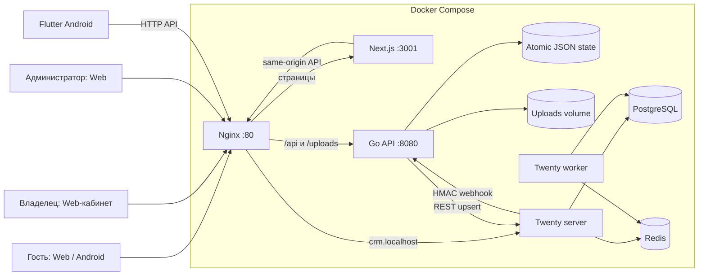
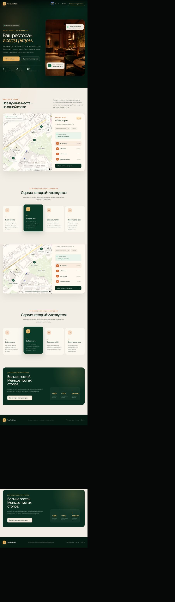
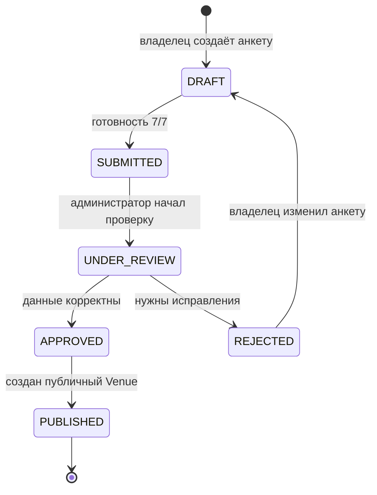
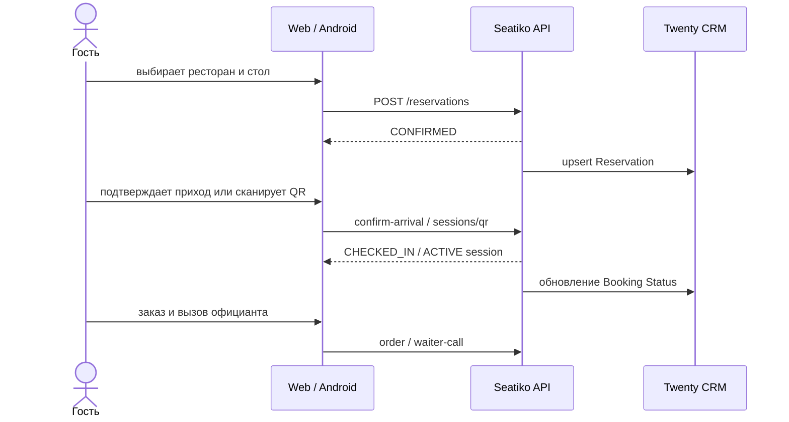
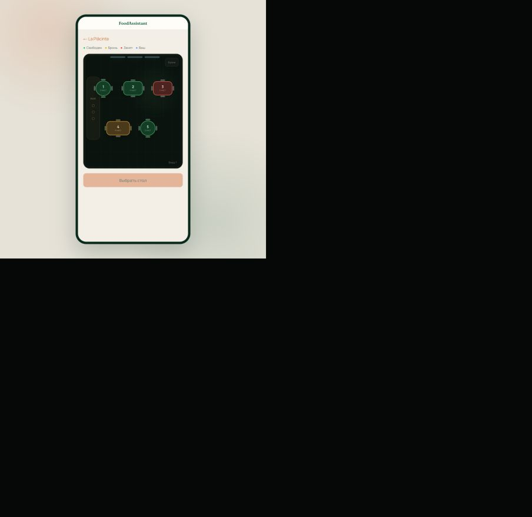
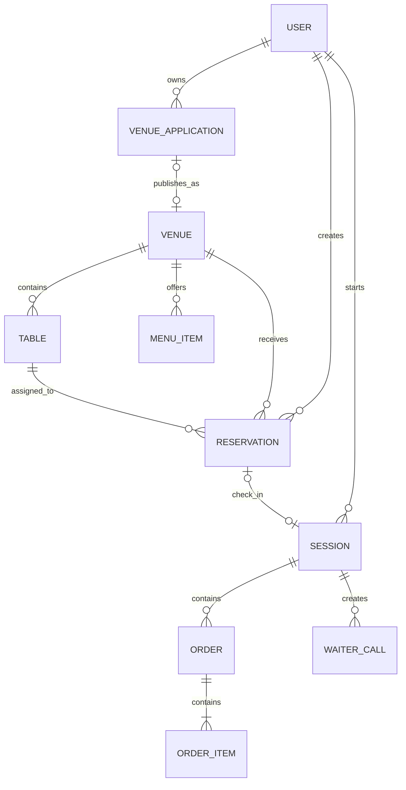
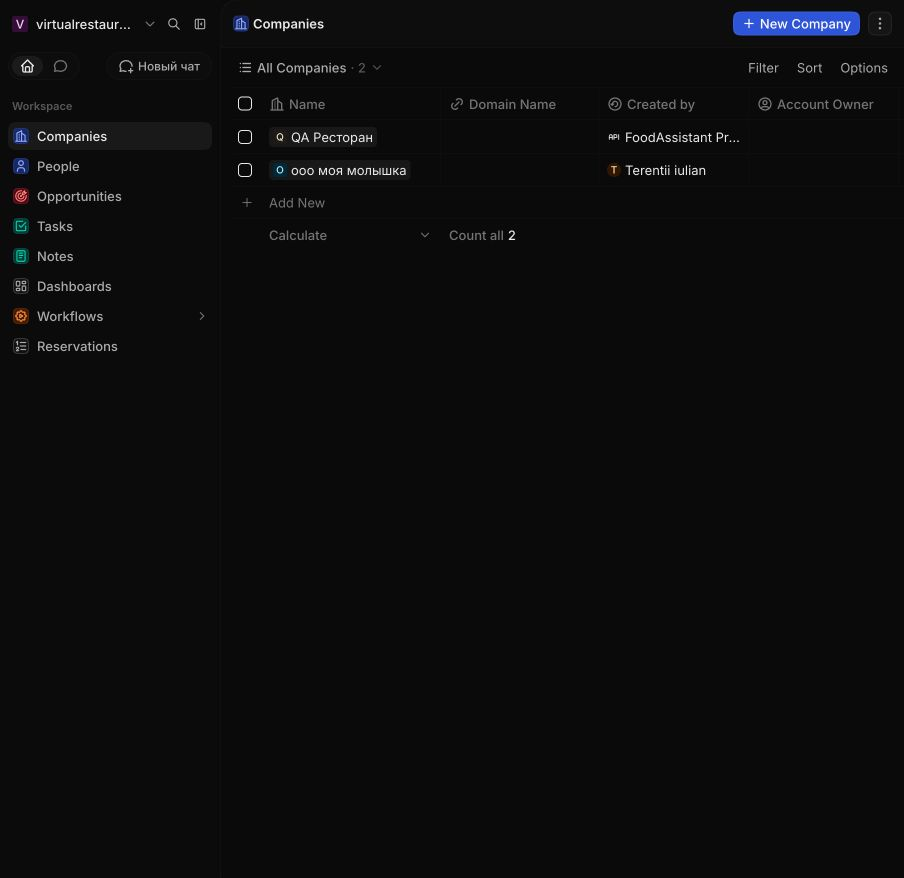
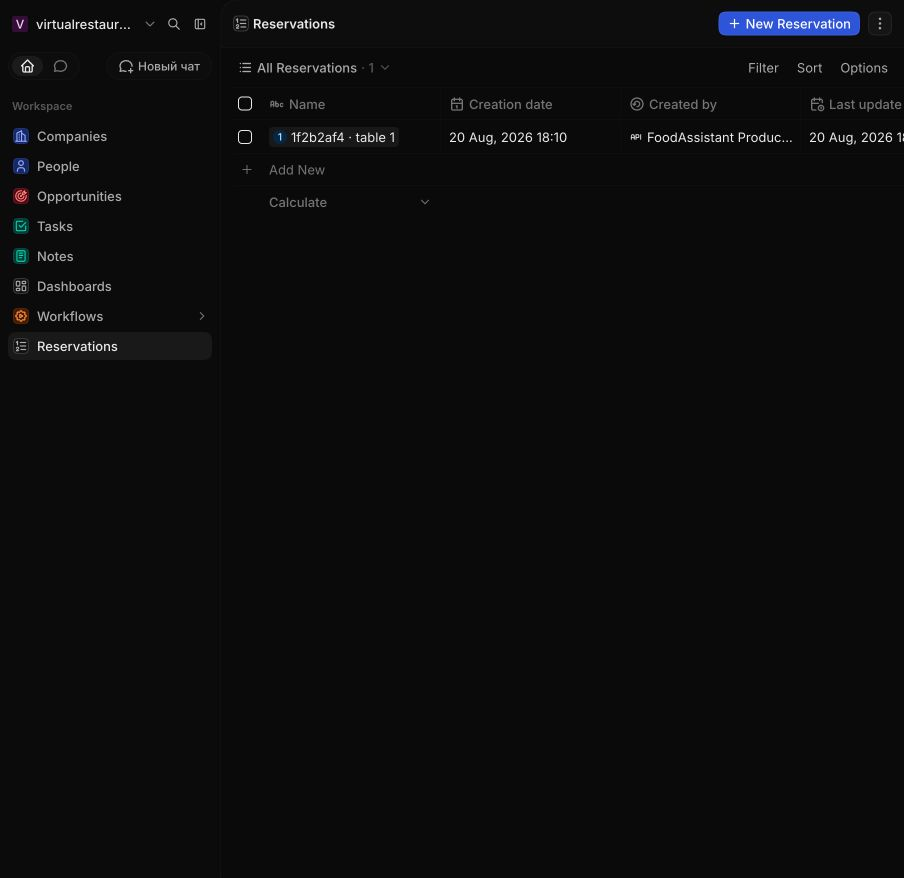

# Seatiko — Engineering & operations

> **Canonical entry for the whole repo:** [`../README.md`](../README.md)  
> **All documentation index:** [`README.md`](./README.md)  
> **Product rules (guest flows, profile, alcohol, UX):** [`APP_LOGIC.md`](./APP_LOGIC.md) · [`UX_SCREENS.md`](./UX_SCREENS.md)  
> **Code runbook + screenshots:** [`../seatiko/README.md`](../seatiko/README.md)

This file is the full engineering / Docker / API / CRM / production guide formerly living at the repository root README. Content is preserved here so the root can stay a short documentation map.

---

## Содержание

- [Возможности](#возможности)
- [Архитектура](#архитектура)
- [Структура репозитория](#структура-репозитория)
- [Роли и пользовательские сценарии](#роли-и-пользовательские-сценарии)
- [Модель данных](#модель-данных)
- [Быстрый запуск](#быстрый-запуск)
- [Адреса сервисов](#адреса-сервисов)
- [Настройка Twenty CRM](#настройка-twenty-crm)
- [API](#api)
- [Примеры полного сценария](#примеры-полного-сценария)
- [Постоянное хранение и резервные копии](#постоянное-хранение-и-резервные-копии)
- [Тестирование](#тестирование)
- [Диагностика](#диагностика)
- [Безопасность и production](#безопасность-и-production)

## Возможности

### Для гостя

- регистрация и вход;
- выбор города;
- карта опубликованных ресторанов;
- фильтрация и AI-поиск по естественному запросу;
- карточка заведения, меню и цены;
- интерактивная схема столиков;
- бронирование конкретного столика;
- подтверждение прихода;
- QR-сессия за столом;
- заказ блюд;
- вызов официанта;
- история заказов и бронирований;
- интерфейс RU / EN / RO.

### Для владельца ресторана

- отдельная регистрация с ролью `restaurant`;
- черновик анкеты без потери заполненных данных;
- адрес и точка на встроенной карте;
- контакты и необязательный сайт ресторана;
- до 8 фотографий JPG, PNG или WebP, каждая до 5 МБ;
- проверка готовности анкеты;
- отправка на модерацию;
- причина возврата на исправление;
- история всех изменений;
- список бронирований своего опубликованного заведения.

### Для администратора

- очередь заявок;
- начало проверки;
- одобрение или возврат с обязательной причиной;
- публикация ресторана;
- ручной запуск CRM reconcile;
- контроль состояния синхронизации.

### Для команды CRM

- владельцы и гости в `People`;
- рестораны в `Companies`;
- бронирования в `Reservations`;
- связи владелец → ресторан и бронь → ресторан/гость;
- Timeline изменений;
- двустороннее обновление разрешённых полей;
- защита ролей, паролей, модерации и публикации от изменения через CRM.

## Архитектура

### Общая схема



### Маршрутизация

Nginx является единой точкой входа:

```text
http://localhost/          → Next.js
http://localhost/api/...   → Go API
http://localhost/uploads/  → загруженные фотографии
http://localhost/healthz   → health check API
http://crm.localhost/      → Twenty CRM
```

Backend напрямую не публикует порт `8080` на компьютере. Web использует same-origin URL `/api`, а Android Emulator обращается к Nginx через `http://10.0.2.2`.

### Карта

Карта не требует Google Cloud или банковской карты:

- MapLibre GL JS — сайт;
- MapLibre Native — Flutter;
- OpenFreeMap — векторные тайлы;
- OpenStreetMap — геоданные;
- Seatiko API — точки ресторанов и их состояние.



## Структура репозитория

```text
Virtual-restaurant-/
├── README.md                         # главный вход (карта документации)
├── docker-compose.yml                # весь локальный стек
├── .env                              # настройки Docker/Twenty
├── .env.keys                         # API key и webhook secret CRM
├── config/nginx/                     # единый reverse proxy
├── docs/                             # вся документация, прототип, диаграммы
│   ├── README.md                     # индекс docs
│   ├── ENGINEERING.md                # этот файл
│   ├── APP_LOGIC.md · UX_SCREENS.md · …  # продукт
│   ├── prototype/ · diagrams/
│   └── superpowers/
├── seatiko/
│   ├── apps/web/                     # Next.js, TypeScript, MapLibre
│   ├── apps/mobile/                  # Flutter Android
│   ├── services/api/                 # Go, Gin, JWT, storage, CRM sync
│   ├── docs/images/                  # скриншоты README
│   └── README.md                     # пошаговая инструкция со скриншотами
└── twenty/                           # исходный код Twenty CRM
```

## Роли и пользовательские сценарии

| Роль | Значение API | Интерфейс | Основные права |
|---|---|---|---|
| Гость | `guest` | сайт и Android | карта, бронь, QR-сессия, заказ |
| Владелец | `restaurant` | `/cabinet` | анкета ресторана, фото, история, брони |
| Администратор | `admin` | `/admin` | модерация, публикация, CRM reconcile |

Администратора нельзя зарегистрировать публичным запросом. Локальные seed-аккаунты:

```text
email: admin@seatiko.local
password: admin123

email: guest@seatiko.local
password: guest123
```

Это только development-аккаунты.

### Подключение ресторана



Готовность 7/7 требует:

1. название и описание;
2. адрес;
3. допустимые ненулевые координаты;
4. минимум одну кухню;
5. телефон и корректный email;
6. часы работы;
7. минимум одну фотографию.

### Бронирование и посещение





## Модель данных



### Основные статусы

| Сущность | Статусы |
|---|---|
| Заявка | `DRAFT`, `SUBMITTED`, `UNDER_REVIEW`, `APPROVED`, `REJECTED`, `PUBLISHED` |
| Стол | `FREE`, `RESERVED`, `OCCUPIED`, `CLEANING` |
| Бронь | `CONFIRMED`, `CHECKED_IN`, `CANCELLED`, `NO_SHOW` |
| Сессия | `ACTIVE`, `CLOSED` |
| Заказ | `DRAFT`, `SUBMITTED`, `PREPARING`, `READY`, `SERVED`, `PAID`, `CANCELLED` |
| Вызов | `PENDING`, `ACCEPTED`, `DONE` |

## Быстрый запуск

### Требования

- Docker Desktop с Docker Compose v2;
- свободный порт `80` или значение `HTTP_PORT` в `.env`;
- Flutter SDK и Android Studio — только для Android-разработки;
- Node.js 22 и Go 1.25 — только при запуске компонентов без Docker.

### 1. Конфигурация

В этом приватном репозитории рабочие `.env` и `.env.keys` включены по решению владельца. Для нового независимого окружения используйте шаблоны:

```bash
cp .env.example .env
cp .env.keys.example .env.keys
chmod 600 .env .env.keys
```

Минимальные секреты можно сгенерировать так:

```bash
openssl rand -hex 32
openssl rand -base64 32
```

Не меняйте действующий `ENCRYPTION_KEY` Twenty без резервной копии: он используется для расшифровки данных CRM.

### 2. Запуск всего проекта

Из корня репозитория:

```bash
docker compose up -d --build --wait
docker compose ps
```

Compose создаёт volumes на новой установке и использует прежние имена `twenty_db-data` и `twenty_server-local-data`. Порт Nginx по умолчанию доступен на `127.0.0.1`. При смене `HTTP_PORT` укажите тот же порт в `SERVER_URL`, например `http://crm.localhost:8080`.

### 3. Проверка

```bash
curl -fsS http://localhost/healthz
curl -fsS http://localhost/api/v1/map/config
curl -fsS http://crm.localhost/healthz
```

[Swagger UI](http://localhost/api/docs) позволяет вызывать API с JWT, полученным через `POST /api/v1/auth/login`. Спецификация доступна по адресу [OpenAPI](http://localhost/api/openapi.yaml). Для диагностики синхронизации откройте вкладку CRM в админке Seatiko.

## Адреса сервисов

| URL | Назначение |
|---|---|
| http://localhost/ | главная и карта |
| http://localhost/business | страница для ресторанов |
| http://localhost/register | регистрация |
| http://localhost/login | вход |
| http://localhost/cabinet | кабинет владельца |
| http://localhost/admin | модерация |
| http://localhost/demo | гостевой web-сценарий |
| http://localhost/api/v1 | REST API |
| http://localhost/uploads | фотографии |
| http://crm.localhost/ | Twenty CRM |

`crm.localhost` обычно автоматически указывает на `127.0.0.1`. Если система его не разрешает, добавьте в `/etc/hosts`:

```text
127.0.0.1 crm.localhost
```

## Настройка Twenty CRM

### Сопоставление объектов

| Seatiko | Twenty | Ключ синхронизации |
|---|---|---|
| владелец или гость | `People` | `seatikoUserId` |
| заявка/ресторан | `Companies` | `seatikoId` |
| публичный ресторан | Company `venueId` | Venue ID |
| бронь | `Reservations` | `seatikoReservationId` |





### Направления синхронизации

Seatiko → Twenty:

- reconcile после важных изменений;
- фоновая сверка каждые 15 секунд;
- idempotent upsert по стабильным ID;
- автоматическое восстановление после временной ошибки.

Twenty → Seatiko:

- HMAC SHA-256 webhook;
- проверка timestamp;
- игнорирование API-origin echo;
- разрешены профиль, контакты, координаты, цены и рабочий статус брони;
- запрещены пароль, роль, владелец, модерация и публикация.

### Первый запуск Twenty CRM

Порядок настройки workspace, ключа и подписанного webhook описан в [TWENTY_CRM_INTEGRATION.md](./TWENTY_CRM_INTEGRATION.md).

## API

### Общие правила

- Base URL: `http://localhost/api/v1`;
- формат: JSON, кроме multipart-загрузки фото;
- авторизация: `Authorization: Bearer <JWT>`;
- JWT действует 7 дней;
- время: ISO 8601 / RFC 3339, желательно UTC;
- локализованная строка: `{"ru":"...","en":"...","ro":"..."}`;
- ошибка: `{"error":"machine_readable_code"}`.

В примерах ниже используется:

```bash
API=http://localhost/api/v1
```

### Публичные маршруты

| Метод | Маршрут | Назначение |
|---|---|---|
| `GET` | `/healthz` вне `/api/v1` | здоровье API и CRM |
| `GET` | `/cities` | города |
| `GET` | `/venues?city_id=city-balti` | опубликованные рестораны |
| `GET` | `/venues/:id` | карточка ресторана |
| `GET` | `/venues/:id/tables` | схема столиков |
| `GET` | `/venues/:id/menu` | меню |
| `GET` | `/map/places?city_id=city-balti` | гибридный каталог точек карты (Google Places + DB; см. [MAP_ARCHITECTURE.md](./MAP_ARCHITECTURE.md)) |
| `GET` | `/collections` | тематические подборки |
| `POST` | `/discover/ai` | keyword/AI-поиск (mobile / legacy; web wizard не вызывает) |
| `POST` | `/auth/register` | регистрация гостя/владельца |
| `POST` | `/auth/login` | получение JWT |
| `GET` | `/integrations/twenty/status` | состояние CRM sync |
| `POST` | `/integrations/twenty/webhook` | подписанный webhook Twenty |

### Поиск свободных столов

Очередь бэкенд-задач: [`BACKEND_TASKS.md`](./BACKEND_TASKS.md) №2 (сделано).

Страница `/book` делает один запрос `GET /api/v1/availability` (плюс `GET /venues` для карточек). Столы ресторана подгружаются только при открытии формы брони.

| Метод | Маршрут | Назначение |
|---|---|---|
| `GET` | `/availability?city_id=&at=<RFC3339>&date=YYYY-MM-DD&guests=N&duration_min=M&window_min=90&limit=4` | все рестораны города; для каждого — подходит ли стол на `guests`, ближайшие свободные начала около `at` и стол для каждого |

Параметры: `city_id` (по умолчанию `city-balti`, `all` — все города), `at` — желаемое начало; без него берутся первые свободные начала дня `date` (по умолчанию сегодня). `guests` 1–50 (по умолчанию 2), `duration_min` 0–480 (0 — длительность ресторана по умолчанию), `window_min` 0–360, `limit` 1–12. Не дальше 90 дней вперёд. Лимит 60 запросов в минуту.

Ответ: `{ "timezone": "Europe/Chisinau", "venues": [{ "venue_id", "duration_min", "fits", "exact", "slots": [{ "starts_at", "table_id", "table_number" }], "later_today"? }] }`. Сортировка: точное совпадение → ближе по времени → рейтинг. `later_today` — первые свободные начала дня, если около `at` ничего нет.

Правила (`internal/store/availability.go`):

- свободен = `CreateReservationWithDuration` примет этот стол в это время (`tableBusyAtLocked`: брони, их окна, занятые и убираемые столы);
- шаг — `booking_interval_min`; длительность — самая длинная из предлагаемых ресторану, не больше запрошенной (как `durationOptions` во фронте);
- только в часы работы (`hours_text` ресторана, время `Europe/Chisinau`, закрытие после полуночи поддерживается; без часов — 10:00–23:00) и не раньше чем через 15 минут от текущего момента;
- выбирается самый маленький подходящий стол.

Часы работы теперь хранятся на сервере: поле `hours_text` у `Venue` (сид в `internal/store/venue_hours.go`, backfill старых снапшотов, копируется из анкеты при публикации и одобрении изменений профиля). Тесты: `internal/store/availability_test.go` (в том числе каждое предложенное время реально бронируется) и `TestAvailabilityEndpoint`.

`apps/web/src/lib/venue-availability.ts`: `fromApiAvailability` переводит ответ сервера в формат карточек; браузерный расчёт `venueAvailability` остался для тестов и экранов одного ресторана. Отображаемые часы по локалям по-прежнему в `apps/web/src/lib/venue-hours.ts`.

### Маршруты пользователя с JWT

| Метод | Маршрут | Назначение |
|---|---|---|
| `GET/PATCH` | `/me` | профиль пользователя |
| `POST/GET` | `/reservations` | создать / получить свои брони; `duration_min` — длительность, выбранная гостем (30 … `max_visit_duration_min`) |
| `POST` | `/reservations/:id/confirm-arrival` | подтвердить приход; `expected_arrival` — до `reserved_for` + 30 мин (опоздание) |
| `POST` | `/tables/:id/watch` | наблюдать за столом 2 часа |
| `POST` | `/sessions/qr` | открыть QR-сессию |
| `GET/POST` | `/sessions/:id` / `/sessions/:id/close` | получить / закрыть сессию |
| `POST` | `/sessions/:id/orders` | создать заказ |
| `POST` | `/sessions/:id/waiter-calls` | вызвать официанта |
| `GET` | `/orders` | свои заказы |
| `GET` | `/staff/waiter-calls?venue_id=...` | вызовы по ресторану |
| `POST` | `/staff/waiter-calls/:id/accept` | принять вызов |
| `GET` | `/me/venues/:id/preorder-menu` | меню для предзаказа от лица гостя: у каждой позиции `orderable` и `blocked_reason` (`age_verification_required` для 18+ без разрешения) |
| `POST` | `/staff/reservations/:id/adult-verification` | официант / владелец / админ подтверждает 18+ гостя этой брони (тело: `id_document_checked: true`, `id_document_type`: `id_card` / `passport` / `other`) |
| `POST` | `/staff/venues/:venueId/guests/:userId/adult-verification/revoke` | владелец или админ отзывает 18+ (тело: `reason`, необязательно) |

| `GET/PUT/DELETE` | `/reservations/:id/preorder` | предзаказ блюд к своей брони: получить / создать или заменить (`items: [{menu_item_id, qty}]`) / отменить |
| `POST` | `/staff/orders/:id/age-check` | проверка документа перед подачей 18+ из предзаказа (`id_document_checked`, `approved`) |

#### Предзаказ к брони (`internal/store/preorder.go`, APP_LOGIC §5.3, §7)

- Предзаказ — это `Order` с `preorder: true` и `reservation_id`; персонал видит его в `GET /staff/orders`, гость — в `GET /orders` и в `preorder` своей брони, владелец и персонал — в списках броней.
- Создать или изменить можно только для своей брони в статусе `CONFIRMED`, если у ресторана включён `allow_preorder`, и до `kitchen_at` = `reserved_for` − `preorder_lead_min` (правило ресторана 0–180 мин, по умолчанию 30). После `kitchen_at` у заказа `kitchen_due: true` — кухне пора начинать.
- Цена фиксируется при сохранении; блюдо, позже удалённое или в стоп-листе, отмечается `unavailable: true`. Стоп-лист при сохранении — `item_unavailable` (409), чужое блюдо — 404, пустой список или `qty` вне 1–20 — `invalid_items` (400).
- 18+: без `adult_preorder_allowed` — `age_verification_required` (403); алкоголь только у ресторана с лицензией. Позиции 18+ сохраняются с `age_check: PENDING_AGE_CHECK`; пока персонал не проверил документ (`/staff/orders/:id/age-check`), заказ нельзя отметить `SERVED` / `PAID` и оплатить (`age_check_pending`, 409). Отказ убирает позиции 18+ из заказа. Отзыв 18+ убирает их из ещё не начатых предзаказов гостя (`adult_items_removed_at`).
- Отмена брони отменяет её предзаказ; при check-in по QR предзаказ привязывается к сессии стола.
- В `kitchen_at` фоновый планировщик API (раз в 30 с, `StartPreorderKitchen`) переводит предзаказ в `PREPARING` и уведомляет кухню и гостя.
- Веб: ссылка «Предзаказать еду к приходу» после брони и кнопка в кабинете гостя ведут в `/venues/:id/menu?preorder=<reservation id>`; там «Ваш выбор» отправляется в ресторан (`PUT`), меняется и отменяется до `kitchen_at`; позиции 18+ без разрешения помечены и не отправляются (`GET /me/venues/:id/preorder-menu`). Без `?preorder=<id>` список по-прежнему только на устройстве.

#### Уведомления (`internal/store/notifications.go`, APP_LOGIC §13)

| Метод | Маршрут | Назначение |
|---|---|---|
| `GET` | `/me/notifications?unread=1&limit=50` | свои уведомления (новые сверху) и `unread` |
| `POST` | `/me/notifications/read` | прочитать `ids` или все |
| `GET` | `/me/notifications/stream` | Server-Sent Events: `ready` (`unread`), затем `notification` на каждое новое; ping каждые 25 с |

- События: `PREORDER_CREATED` / `UPDATED` / `CANCELLED` — владельцу и активному персоналу ресторана; `PREORDER_PREPARING` — кухне и гостю; `PREORDER_ADULT_REMOVED`, `PREORDER_AGE_REFUSED`, `ADULT_GRANTED`, `ADULT_REVOKED` — гостю. Хранятся в снапшоте, до 200 на пользователя.
- Поток читается через `fetch` (токен в заголовке `Authorization`, `EventSource` не умеет); nginx отдаёт `/api/v1/me/notifications/stream` без буферизации (`config/nginx/nginx.conf`).
- Веб: колокольчик в шапке (`components/notifications-bell.tsx`) — счётчик, список, «прочитать все»; переподключение с паузой 3–60 с и опрос раз в минуту, пока поток недоступен.
- Push на телефон / в закрытый браузер (Web Push, FCM) пока нет: уведомления приходят, когда сайт открыт, и ждут в списке.

#### 18+ и предзаказ (`internal/store/adult.go`, APP_LOGIC §8.4)

- `requires_age_18` у позиции меню; для `contains_alcohol` всегда `true` (при сохранении, в сиде и при загрузке снапшота).
- `adult_preorder_allowed` и `adult_verification` у `User` (кто, с какой ролью, где, когда, какой документ, кто отозвал). Гость видит их только для чтения: `PATCH /me` их не меняет.
- Выдать можно только по брони в статусе `CHECKED_IN` не старше 12 часов, только с `id_document_checked: true`, только сотрудником этого заведения (роль `waiter`), владельцем (`manager`) или админом; себе выдать нельзя. Ошибки: `id_document_required` (400), `invalid_id_document_type` (400), `visit_required` (409), `forbidden` (403).
- Отозвать может владелец заведения, где у гостя была бронь, или админ платформы; официант — нет.
- Каждая выдача и отзыв пишутся в журнал (`adult_permission_log` в снапшоте, `GET /admin/adult-permission-log?user_id=`).
- Предзаказ (BACKEND_TASKS №1) проверяет каждую позицию так же, как `CanPreorderItem`.

### Маршруты владельца

| Метод | Маршрут | Назначение |
|---|---|---|
| `POST/GET` | `/restaurant/applications` | создать / получить анкеты |
| `GET/PATCH` | `/restaurant/applications/:id` | получить / изменить анкету |
| `POST` | `/restaurant/applications/:id/photos` | загрузить фото |
| `DELETE` | `/restaurant/applications/:id/photos` | удалить фото |
| `POST` | `/restaurant/applications/:id/submit` | отправить на модерацию |
| `GET` | `/restaurant/applications/:id/activity` | история анкеты |
| `GET` | `/restaurant/reservations` | брони заведений владельца |

### Маршруты администратора

| Метод | Маршрут | Назначение |
|---|---|---|
| `GET` | `/admin/applications?status=SUBMITTED` | очередь заявок |
| `POST` | `/admin/applications/:id/review` | review/approve/reject |
| `POST` | `/admin/applications/:id/publish` | публикация |
| `POST` | `/admin/integrations/twenty/reconcile` | немедленная CRM-сверка |
| `GET` | `/admin/adult-permission-log?user_id=` | журнал выдачи и отзыва 18+ |

## Примеры полного сценария

### 1. Публичный каталог

```bash
curl -s "$API/cities" | jq
curl -s "$API/venues?city_id=city-balti" | jq

# Гибридная карта (партнёры + Google food places)
curl -s "$API/map/places?city_id=city-balti" | jq '{source, n:(.places|length), in_db:(.places|map(select(.in_database))|length)}'

VENUE_ID=$(curl -s "$API/venues?city_id=city-balti" | jq -r '.venues[0].id')
curl -s "$API/venues/$VENUE_ID" | jq
curl -s "$API/venues/$VENUE_ID/tables" | jq
curl -s "$API/venues/$VENUE_ID/menu" | jq
```

AI/keyword-поиск (не используется web `/discover` wizard):

```bash
curl -s -X POST "$API/discover/ai" \
  -H 'Content-Type: application/json' \
  -d '{"query":"молдавская кухня, свободный столик и средний чек до 400 лей"}' | jq
```

### 2. Регистрация владельца и создание ресторана

```bash
OWNER_RESPONSE=$(curl -s -X POST "$API/auth/register" \
  -H 'Content-Type: application/json' \
  -d '{
    "email":"owner@example.test",
    "password":"strong-password",
    "first_name":"Ion",
    "last_name":"Popescu",
    "locale":"ro",
    "role":"restaurant"
  }')

OWNER_TOKEN=$(jq -r '.token' <<<"$OWNER_RESPONSE")
```

Создание пустой анкеты:

```bash
APPLICATION_RESPONSE=$(curl -s -X POST "$API/restaurant/applications" \
  -H "Authorization: Bearer $OWNER_TOKEN")

APPLICATION_ID=$(jq -r '.application.id' <<<"$APPLICATION_RESPONSE")
```

Заполнение:

```bash
curl -s -X PATCH "$API/restaurant/applications/$APPLICATION_ID" \
  -H "Authorization: Bearer $OWNER_TOKEN" \
  -H 'Content-Type: application/json' \
  -d '{
    "name":{"ru":"Casa Bunicii","en":"Grandmas House","ro":"Casa Bunicii"},
    "description":{"ru":"Домашняя молдавская кухня","en":"Moldovan home cooking","ro":"Bucătărie moldovenească"},
    "address":{"ru":"Бельцы, ул. Индепенденцей 10","en":"10 Independentei St, Balti","ro":"str. Independenței 10, Bălți"},
    "cuisine":["moldovan","european"],
    "phone":"+37360000000",
    "email":"restaurant@example.test",
    "website":"https://restaurant.example.test",
    "city_id":"city-balti",
    "lat":47.7617,
    "lng":27.9288,
    "price_level":2,
    "average_check":350,
    "hours_text":"Пн–Вс 10:00–23:00"
  }' | jq
```

Фото и отправка:

```bash
curl -s -X POST "$API/restaurant/applications/$APPLICATION_ID/photos" \
  -H "Authorization: Bearer $OWNER_TOKEN" \
  -F 'photo=@/absolute/path/to/restaurant.jpg' | jq

curl -s -X POST "$API/restaurant/applications/$APPLICATION_ID/submit" \
  -H "Authorization: Bearer $OWNER_TOKEN" | jq
```

### 3. Модерация и публикация

```bash
ADMIN_RESPONSE=$(curl -s -X POST "$API/auth/login" \
  -H 'Content-Type: application/json' \
  -d '{"email":"admin@seatiko.local","password":"admin123"}')

ADMIN_TOKEN=$(jq -r '.token' <<<"$ADMIN_RESPONSE")

curl -s -X POST "$API/admin/applications/$APPLICATION_ID/review" \
  -H "Authorization: Bearer $ADMIN_TOKEN" \
  -H 'Content-Type: application/json' \
  -d '{"status":"UNDER_REVIEW"}' | jq

curl -s -X POST "$API/admin/applications/$APPLICATION_ID/review" \
  -H "Authorization: Bearer $ADMIN_TOKEN" \
  -H 'Content-Type: application/json' \
  -d '{"status":"APPROVED"}' | jq

curl -s -X POST "$API/admin/applications/$APPLICATION_ID/publish" \
  -H "Authorization: Bearer $ADMIN_TOKEN" | jq
```

Возврат вместо одобрения:

```bash
curl -s -X POST "$API/admin/applications/$APPLICATION_ID/review" \
  -H "Authorization: Bearer $ADMIN_TOKEN" \
  -H 'Content-Type: application/json' \
  -d '{"status":"REJECTED","reject_reason":"Уточните часы работы и добавьте фото фасада"}' | jq
```

### 4. Бронирование столика

```bash
GUEST_RESPONSE=$(curl -s -X POST "$API/auth/register" \
  -H 'Content-Type: application/json' \
  -d '{
    "email":"guest@example.test",
    "password":"strong-password",
    "first_name":"Ana",
    "last_name":"Rusu",
    "locale":"ru",
    "role":"guest"
  }')

GUEST_TOKEN=$(jq -r '.token' <<<"$GUEST_RESPONSE")
VENUE_ID=$(curl -s "$API/venues?city_id=city-balti" | jq -r '.venues[0].id')
TABLE_ID=$(curl -s "$API/venues/$VENUE_ID/tables" | jq -r '.tables[] | select(.status=="FREE") | .id' | head -1)

RESERVATION_RESPONSE=$(curl -s -X POST "$API/reservations" \
  -H "Authorization: Bearer $GUEST_TOKEN" \
  -H 'Content-Type: application/json' \
  -d "{
    \"venue_id\":\"$VENUE_ID\",
    \"table_id\":\"$TABLE_ID\",
    \"guests\":2,
    \"reserved_for\":\"2027-01-20T18:30:00Z\",
    \"source\":\"WEB\"
  }")

RESERVATION_ID=$(jq -r '.reservation.id' <<<"$RESERVATION_RESPONSE")

curl -s -X POST "$API/reservations/$RESERVATION_ID/confirm-arrival" \
  -H "Authorization: Bearer $GUEST_TOKEN" | jq
```

Android отправляет тот же запрос с `"source":"ANDROID"`.

### 5. QR-сессия, заказ и официант

В MVP принимается любой непустой QR token, например `demo`:

```bash
SESSION_RESPONSE=$(curl -s -X POST "$API/sessions/qr" \
  -H "Authorization: Bearer $GUEST_TOKEN" \
  -H 'Content-Type: application/json' \
  -d "{\"venue_id\":\"$VENUE_ID\",\"table_id\":\"$TABLE_ID\",\"token\":\"demo\"}")

SESSION_ID=$(jq -r '.session.id' <<<"$SESSION_RESPONSE")
MENU_ITEM_ID=$(curl -s "$API/venues/$VENUE_ID/menu" | jq -r '.menu[0].id')

curl -s -X POST "$API/sessions/$SESSION_ID/orders" \
  -H "Authorization: Bearer $GUEST_TOKEN" \
  -H 'Content-Type: application/json' \
  -d "{\"items\":[{\"menu_item_id\":\"$MENU_ITEM_ID\",\"qty\":2}]}" | jq

curl -s -X POST "$API/sessions/$SESSION_ID/waiter-calls" \
  -H "Authorization: Bearer $GUEST_TOKEN" \
  -H 'Content-Type: application/json' \
  -d '{"reason":"bill"}' | jq

curl -s -X POST "$API/sessions/$SESSION_ID/close" \
  -H "Authorization: Bearer $GUEST_TOKEN" | jq
```

Допустимые причины вызова: `order`, `bill`, `question`, `other`, `initial`.

### 6. CRM status и ручная сверка

```bash
curl -s "$API/integrations/twenty/status" | jq

curl -s -X POST "$API/admin/integrations/twenty/reconcile" \
  -H "Authorization: Bearer $ADMIN_TOKEN" | jq
```

## Постоянное хранение и резервные копии

### Seatiko

API использует atomic JSON snapshot:

```text
/app/data/seatiko-state.json
```

Он содержит пользователей с bcrypt-хешами, заявки, рестораны, столы, брони, сессии, заказы и историю. Запись выполняется через временный файл и atomic rename. Файл внутри volume имеет права `600`.

Volumes:

| Volume | Данные |
|---|---|
| `virtual-restaurant_api-data` | состояние API |
| `virtual-restaurant_api-uploads` | фотографии |
| `twenty_db-data` | PostgreSQL Twenty |
| `twenty_server-local-data` | локальные файлы Twenty |

Просмотр:

```bash
docker volume ls | rg 'virtual-restaurant|twenty'
```

Перед ручным переносом или восстановлением остановите изменяющие данные сервисы и сделайте резервную копию всех четырёх volumes. Для production используйте регулярный `pg_dump`, объектное хранилище и проверяемую процедуру восстановления.

## Тестирование

### Backend

```bash
cd seatiko/services/api
go test ./...
```

### Web

```bash
cd seatiko/apps/web
npm ci
npm run lint
npm run build -- --webpack
```

### Android

```bash
cd seatiko/apps/mobile
flutter pub get
flutter analyze
flutter test
```

Запуск Android Emulator:

```bash
flutter run --dart-define=API_URL=http://10.0.2.2
```

### Docker и документация

```bash
cd /Users/iulian/Documents/work/project1
docker compose config --quiet
git diff --check
curl -fsS http://localhost/healthz | jq
```

## Диагностика

### Состояние контейнеров

```bash
docker compose ps
docker compose logs --tail=100 api
docker compose logs --tail=100 web
docker compose logs --tail=100 twenty-server twenty-worker
```

### CRM отключена

Симптом:

```json
{"enabled":false,"healthy":false}
```

Проверить:

1. существует `.env.keys`;
2. API key активен в Twenty;
3. `docker compose up -d --force-recreate api` выполнен после изменения ключа;
4. `http://crm.localhost/healthz` доступен;
5. в API logs нет `crm_sync_failed`.

### Webhook получает 401

- secret Twenty должен совпадать с `TWENTY_WEBHOOK_SECRET`;
- timestamp и подпись должны передаваться в заголовках Twenty;
- после ротации secret пересоздайте API-контейнер;
- проверьте `docker compose logs api | rg twenty/webhook`.

### Webhook не доходит локально

- URL должен быть `http://api.seatiko.local:8080/api/v1/integrations/twenty/webhook`;
- у `twenty-worker` должен быть `OUTBOUND_HTTP_SAFE_MODE_ENABLED=false`;
- worker должен быть запущен;
- в production не отключайте safe mode — используйте публичный HTTPS URL.

### Карта пустая

- проверить доступ к OpenFreeMap и OpenStreetMap;
- проверить `GET /api/v1/venues?city_id=city-balti`;
- убедиться, что ресторан имеет статус `PUBLISHED`;
- проверить координаты и отсутствие нулевых `lat/lng`.

### Фото не загружается

- допустимы JPG, PNG, WebP;
- размер одного файла — до 5 МБ;
- максимум — 8 фото;
- заявка должна быть `DRAFT` или `REJECTED`;
- проверить volume `api-uploads`.

### `crm.localhost` не открывается

```bash
curl -I http://crm.localhost/
```

Если имя не разрешается, добавьте `127.0.0.1 crm.localhost` в `/etc/hosts`.

## Безопасность и production

### Секреты в приватном репозитории

По явному решению владельца проекта рабочие `.env` и `.env.keys` включаются в этот приватный репозиторий. Это удобно для единственного владельца, но всё равно означает, что GitHub и вся история Git содержат секреты.

Если репозиторий когда-либо станет публичным или появится новый участник:

1. немедленно отозвать Twenty API keys;
2. сменить JWT и `APP_SECRET`;
3. сменить пароль PostgreSQL;
4. не менять `ENCRYPTION_KEY` без официальной процедуры миграции и backup;
5. очистить Git history специализированным инструментом;
6. перейти на GitHub Actions Secrets, Vault, SOPS или secrets manager.

Никогда не выводите содержимое `.env.keys` в CI logs.

### Что изменить перед production

- заменить `admin123` и отключить публичные development credentials;
- установить длинный случайный `JWT_SECRET`;
- ограничить CORS вместо `*`;
- включить HTTPS;
- включить Twenty outbound safe mode;
- использовать публичный HTTPS webhook;
- создать минимальную CRM-роль вместо Admin API key;
- добавить rate limiting и защиту login/register;
- добавить подтверждение email и восстановление пароля;
- заменить demo QR token на подписанные одноразовые токены;
- перенести Seatiko state из JSON в PostgreSQL перед несколькими API replicas;
- перенести uploads в S3-совместимое хранилище;
- настроить мониторинг, audit retention и резервные копии;
- закрепить точную версию Twenty вместо `latest`;
- добавить CI для Go, Next.js, Flutter и Docker Compose.

## Дополнительная документация

- [Корень репозитория — карта документации](../README.md)
- [Индекс docs](./README.md)
- [Продуктовая логика](./APP_LOGIC.md)
- [Пошаговая инструкция Seatiko со скриншотами](../seatiko/README.md)
- [Правила двусторонней CRM-интеграции](./TWENTY_CRM_INTEGRATION.md)
- [Android](../seatiko/apps/mobile/README.md)
- [Web](../seatiko/apps/web/README.md)
