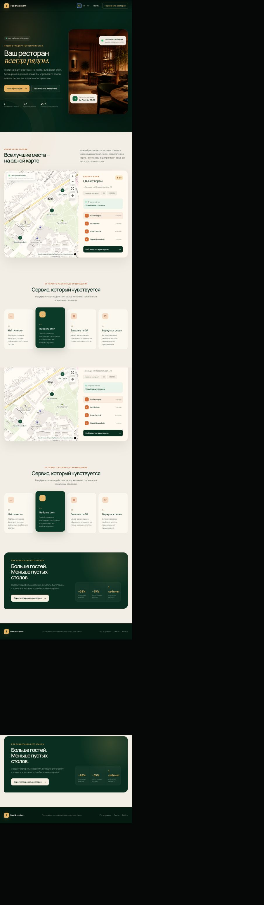
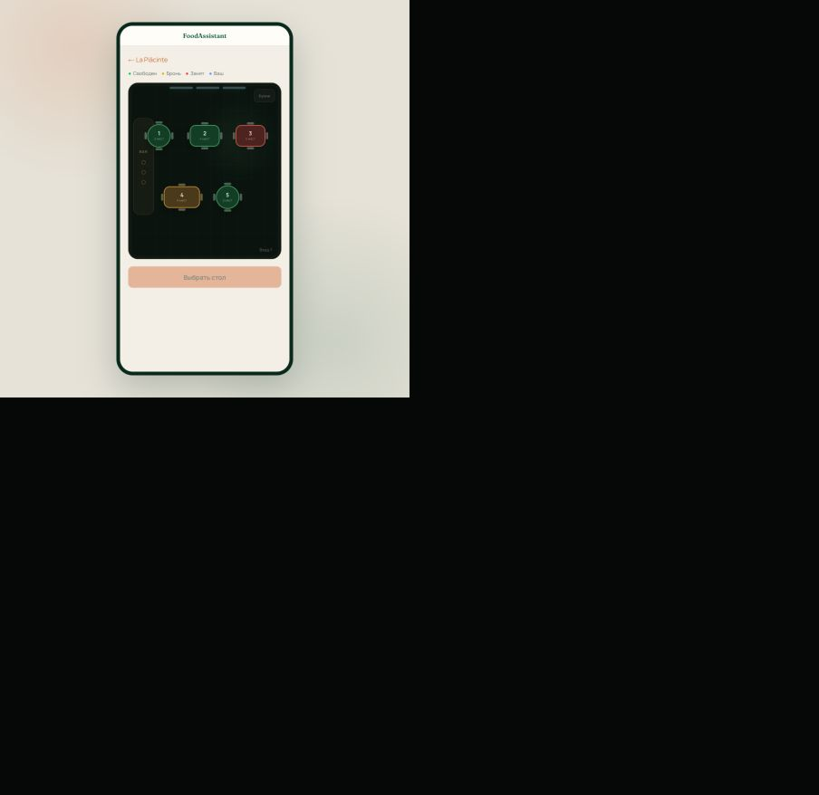
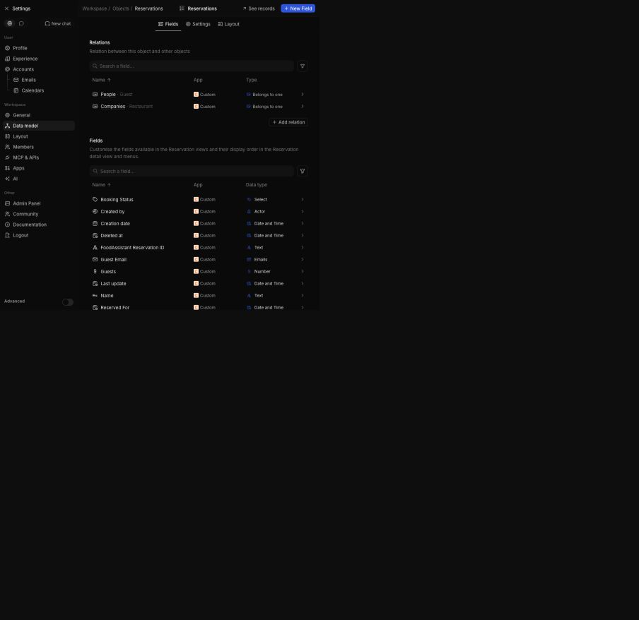
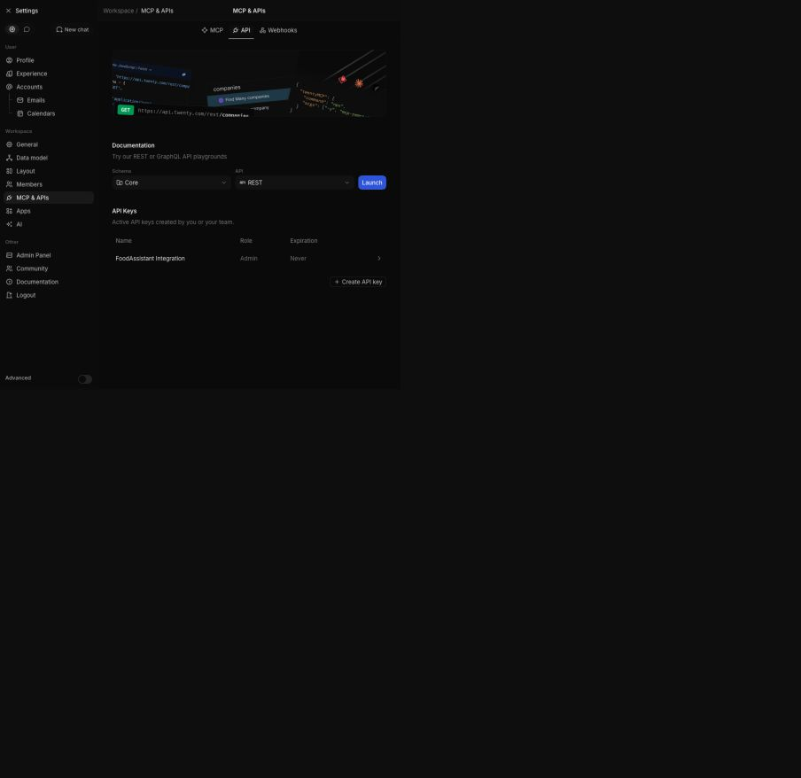

# FoodAssistant

FoodAssistant — единая система для гостя, владельца ресторана и команды модерации. В проект входят сайт, кабинет владельца, гостевой Android-клиент, API и Twenty CRM.

## Что уже работает

| Часть | Назначение | Адрес / путь |
|---|---|---|
| Публичный сайт | Презентация сервиса и карта ресторанов | http://localhost/ |
| Кабинет владельца | Подключение ресторана, профиль, фото, заявки, бронирования и история | http://localhost/cabinet |
| Веб-демо гостя | Карта, карточка ресторана и выбор столика | http://localhost/demo |
| Админка | Модерация и публикация ресторанов | http://localhost/admin |
| Android | Гостевое приложение | `apps/mobile` |
| API | Пользователи, рестораны, столики, брони, заказы | `services/api` |
| CRM | Владельцы, рестораны, бронирования и журнал изменений | http://crm.localhost/ |

Интерфейс сайта поддерживает RU, EN и RO. Выбранный язык сохраняется в браузере и применяется на публичных страницах и в кабинете.

## Запуск проекта

Команды выполняются из `/Users/iulian/Documents/work/project1`:

```bash
docker compose up -d --build
```

Проверка контейнеров:

```bash
docker compose ps
```

### Android

```bash
cd /Users/iulian/Documents/work/project1/foodassistant/apps/mobile
flutter run --dart-define=API_URL=http://10.0.2.2
```

`10.0.2.2` — адрес компьютера из стандартного Android Emulator.

## Карта без платного Google Maps

Карта встроена прямо в сайт и Android-приложение:

- MapLibre GL JS на сайте;
- MapLibre Native во Flutter;
- бесплатные тайлы OpenFreeMap;
- данные OpenStreetMap;
- точки ресторанов из собственного FoodAssistant API.

Google Cloud, банковская карта и отдельное картографическое приложение не нужны. Атрибуция источников показывается на самой карте.



## Пошаговый путь владельца ресторана

### 1. Регистрация

1. Открыть http://localhost/register.
2. Указать имя владельца, email, телефон и пароль.
3. После регистрации система открывает кабинет владельца.
4. Гость при этом использует сайт или Android-приложение; ему не показываются инструменты владельца.

### 2. Создание ресторана

В кабинете нажать `Добавить ресторан` и заполнить:

1. название и описание;
2. кухню и часы работы;
3. адрес;
4. точку на встроенной карте;
5. телефон и email заведения;
6. сайт ресторана — необязательное поле;
7. ценовой уровень и средний чек;
8. минимум одну фотографию.

Черновик автоматически хранится в браузере. Перед загрузкой фотографии текстовые поля сначала отправляются в API, поэтому заполненная форма не должна очищаться после добавления фото.

Для пилотной заявки была установлена тестовая точка `47.7617, 27.9288`. Перед реальной публикацией владелец должен проверить маркер на здании ресторана.

### 3. Отправка на модерацию

Кнопка `Отправить на модерацию` становится активной только при готовности 7/7:

- название и описание;
- адрес;
- точка на карте;
- кухня;
- контакты;
- часы работы;
- фотографии.

Текущая пилотная заявка заполнена на 100% и имеет статус `SUBMITTED` / `Отправлено`.

### 4. Проверка и публикация

1. Администратор открывает http://localhost/admin.
2. Переводит заявку в `UNDER_REVIEW`.
3. Одобряет или возвращает владельцу с причиной.
4. После `PUBLISHED` ресторан появляется на карте и становится доступен гостям.

В кабинете владелец видит статус, процент готовности, бронирования и хронологию изменений.

## Бронирование столика

Гость выбирает ресторан на карте, открывает карточку и нажимает `Забронировать`. Затем он видит настоящий план зала с состояниями:

- зелёный — свободен;
- жёлтый — забронирован;
- красный — занят;
- выделенный — выбран гостем.

Одинаковая модель столиков используется на сайте и в Android. Реализация Android находится в `apps/mobile/lib/widgets/restaurant_floor_plan.dart`, веб-сценарий доступен на http://localhost/demo.



## Настройка Twenty CRM

Стандартные объекты и демонстрационные записи Twenty сохранены. Для ресторанного процесса добавлена отдельная структура.

### Companies — рестораны

В `Companies` добавлены поля:

- `Restaurant Status`;
- `FoodAssistant ID`;
- `Cuisine`;
- `Opening Hours`;
- `Average Check MDL`;
- `Restaurant Phones`;
- `Restaurant Emails`;
- `Latitude` и `Longitude`;
- связь `Reservations`.

Создано представление `Restaurants` с фильтром `Restaurant Status is not empty`. Оно отделяет рестораны от стандартных B2B-компаний Twenty.

### People — владельцы и гости

Владелец хранится в `People` и связан с рестораном через поле `Company`. Twenty автоматически записывает создание и каждое изменение в Timeline.

### Reservations — бронирования

Создан пользовательский объект `Reservations` со следующими полями:

| Поле | Тип / назначение |
|---|---|
| `FoodAssistant Reservation ID` | Идентификатор брони в FoodAssistant |
| `Reserved For` | Дата и время |
| `Guests` | Количество гостей |
| `Table Number` | Номер столика |
| `Guest Email` | Контакт гостя |
| `Booking Status` | `CONFIRMED`, `CHECKED_IN`, `CANCELLED`, `NO_SHOW` |
| `Source` | `WEB`, `ANDROID`, `IOS`, `PHONE`, `WALK_IN` |
| `Restaurant` | Связь с `Company` |
| `Guest` | Связь с `Person` |



### API-доступ CRM

В `Settings → MCP & APIs → API` создан ключ `FoodAssistant Integration` с ролью Admin. Сам секрет не записан в README и не должен попадать в Git.



Для локальной интеграции храните секрет только в игнорируемом файле `/Users/iulian/Documents/work/project1/.env.keys`:

```env
TWENTY_API_KEY=вставьте_секрет_сюда
```

Шаблон находится в `/Users/iulian/Documents/work/project1/.env.keys.example`. Если значение ключа не было сохранено при создании, ключ следует отозвать в CRM и создать новый: Twenty показывает секрет только один раз.

## Рекомендуемая автоматизация CRM

После подключения API синхронизация должна работать так:

1. регистрация владельца → `Person`;
2. создание анкеты → `Company` со статусом `DRAFT`;
3. отправка заявки → статус `SUBMITTED`;
4. начало проверки → `UNDER_REVIEW` и задача модератору;
5. одобрение → `APPROVED`;
6. публикация → `PUBLISHED`;
7. новая бронь → запись `Reservation`, связанная с рестораном и гостем;
8. отмена или приход гостя → обновление `Booking Status`;
9. каждое изменение остаётся в Timeline Twenty и в истории кабинета FoodAssistant.

## Проверка перед демонстрацией

1. Открыть сайт и переключить RU → EN → RO.
2. Убедиться, что карта загружена прямо на главной странице.
3. Открыть `/demo`, ресторан и карту зала.
4. Открыть `/cabinet` и проверить статус заявки и историю.
5. В CRM открыть представление `Restaurants` — там должна быть только ресторанная запись.
6. В `Reservations` проверить поля и связи `Restaurant` / `Guest`.
7. Проверить, что стандартные Companies и People Twenty по-прежнему доступны в представлениях `All Companies` и `All People`.

## Безопасность

- Пароли и API-ключи не публикуются в README, исходном коде или скриншотах.
- `.env` и `.env.keys` должны оставаться вне Git.
- Для production лучше создать отдельную роль CRM с минимальными правами вместо Admin.
- Пилот использует in-memory API: перезапуск API-контейнера очищает временные аккаунты, заявки и бронирования. Для production нужна постоянная база данных.
