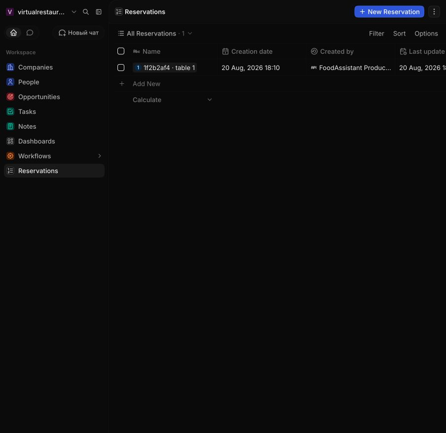

# FoodAssistant

FoodAssistant — единая ресторанная платформа: публичный сайт, кабинет владельца, гостевой Android-клиент, API, модерация и Twenty CRM. Карта и бронирование встроены в сайт и мобильное приложение; отдельное картографическое приложение не требуется.

## Что работает

| Часть | Назначение | Адрес / путь |
|---|---|---|
| Публичный сайт | Презентация и карта опубликованных ресторанов | http://localhost/ |
| Кабинет владельца | Анкета, фото, статус, бронирования и история | http://localhost/cabinet |
| Гостевой web-сценарий | Карточка ресторана и интерактивный план столиков | http://localhost/demo |
| Админка | Модерация и публикация ресторанов | http://localhost/admin |
| Android | Карта, рестораны, план зала и бронирование | `apps/mobile` |
| API | Пользователи, анкеты, рестораны, столики, брони и CRM sync | `services/api` |
| Twenty CRM | Владельцы, рестораны, гости, брони и Timeline | http://crm.localhost/ |

Сайт поддерживает RU, EN и RO. Выбранный язык хранится в браузере и применяется на публичных страницах и в кабинете.

## Быстрый запуск

Из корня `/Users/iulian/Documents/work/project1`:

```bash
docker compose up -d --build
docker compose ps
curl http://localhost/healthz
```

Данные API сохраняются в Docker volume `api-data`, фотографии — в `api-uploads`. Перезапуск или пересборка API больше не удаляет аккаунты, заявки, бронирования и хеши паролей.

### Android

```bash
cd /Users/iulian/Documents/work/project1/foodassistant/apps/mobile
flutter run --dart-define=API_URL=http://10.0.2.2
```

`10.0.2.2` — адрес компьютера из стандартного Android Emulator.

## Архитектура и источники истины

```text
Сайт / Android / кабинет владельца
                 │
                 ▼
          FoodAssistant API
          │       │       │
          │       │       └── постоянный state + uploads
          │       └────────── история кабинета
          ▼
      CRM reconciler ───────────────► Twenty REST API
          ▲                              │
          └──── подписанный webhook ◄────┘
```

- FoodAssistant владеет аккаунтами, ролями, паролями, модерацией и публикацией.
- Twenty хранит рабочую CRM-проекцию и Timeline для команды ресторана.
- Синхронизация FoodAssistant → CRM запускается после изменений и каждые 15 секунд для восстановления после временных ошибок.
- CRM → FoodAssistant работает через HMAC-подписанный webhook.
- Upsert выполняется по стабильным FoodAssistant ID, поэтому повторный запуск не создаёт дубли.
- События, сделанные нашим API-ключом, игнорируются входящим webhook, чтобы не возникал цикл обновлений.

## Путь владельца ресторана

### 1. Регистрация

1. Открыть http://localhost/register.
2. Указать имя владельца, email, телефон и пароль.
3. После регистрации открыть кабинет владельца.
4. Гости используют публичный сайт или Android и не видят инструменты владельца.

### 2. Анкета ресторана

В кабинете нажать `Добавить ресторан` и заполнить:

1. название и описание;
2. кухню и часы работы;
3. адрес и точку на встроенной карте;
4. телефон и email заведения;
5. сайт ресторана, если он есть;
6. ценовой уровень и средний чек;
7. минимум одну фотографию.

Черновик автоматически сохраняется. Перед загрузкой фото текущие текстовые поля отправляются в API, поэтому добавление изображения не очищает уже заполненную форму.

### 3. Готовность и модерация

Кнопка отправки активируется при готовности 7/7:

- название и описание;
- адрес;
- координаты;
- кухня;
- контакты;
- часы работы;
- фотографии.

Далее заявка проходит `DRAFT → SUBMITTED → UNDER_REVIEW → APPROVED → PUBLISHED` или возвращается как `REJECTED` с причиной. Только FoodAssistant может менять эти статусы и публиковать ресторан.

## Бесплатная карта и план столиков

Карта работает без Google Cloud, банковской карты и платного API:

- MapLibre GL JS на сайте;
- MapLibre Native во Flutter;
- бесплатные тайлы OpenFreeMap;
- данные OpenStreetMap;
- точки ресторанов из FoodAssistant API.


При бронировании гость видит одинаковый интерактивный план зала на сайте и Android:

- зелёный — стол свободен;
- жёлтый — забронирован;
- красный — занят;
- выделенный — выбран гостем.


## Совместимость с Twenty CRM

### Соответствие данных

| FoodAssistant | Twenty | Стабильный ключ |
|---|---|---|
| Владелец или гость | `People` | `foodassistantUserId` |
| Заявка/ресторан | `Companies` | `foodassistantId` |
| Опубликованное заведение | поле Company `venueId` | FoodAssistant Venue ID |
| Бронирование | `Reservations` | `foodassistantReservationId` |

Для ресторанов в `Companies` синхронизируются описание, кухня, часы, адрес, координаты, контакты, сайт, ценовой уровень, средний чек, фото, статус, причина возврата и время последнего изменения. Владелец связывается с Company. Бронь связывается одновременно с рестораном и гостем.


В `Reservations` хранятся дата, гости, стол, email, статус и источник `WEB` или `ANDROID`.



### Разрешённые изменения из CRM

Менеджер может вручную менять:

- имя, контакты и язык Person;
- название, описание, кухню, график, контакты, сайт, адрес, координаты и цены ресторана;
- рабочий статус брони: `CONFIRMED`, `CHECKED_IN`, `CANCELLED`, `NO_SHOW`.

CRM не может менять пароли, роли, владельца заявки, модерацию или публикацию. Эти ограничения предотвращают конфликт и случайную публикацию ресторана из CRM.

Каждое разрешённое входящее изменение создаёт запись `CRM_PROFILE_UPDATED` в истории кабинета, а Twenty сохраняет собственный Timeline.

### Какие записи синхронизируются

В CRM отправляются бизнес-записи, связанные с реальной заявкой ресторана. Встроенные seed-рестораны для демонстрации карты не отправляются, пока владелец не создаст для них заявку. Это не даёт CRM смешивать тестовые точки и подключённые рестораны.

На момент настройки проверено:

- 2 Restaurant Companies;
- 3 People;
- 1 Reservation связана с опубликованным рестораном;
- 0 демо Opportunities, 0 демо Dashboards и 0 активных демо Workflows.

## Настройка API и webhook

Секреты хранятся только в `/Users/iulian/Documents/work/project1/.env.keys` с правами `600`. Файл игнорируется Git.

```env
TWENTY_API_KEY=секрет_из_Twenty
TWENTY_WEBHOOK_SECRET=отдельный_случайный_секрет
```

Шаблон: `/Users/iulian/Documents/work/project1/.env.keys.example`.

Для нового workspace сначала создайте API key в `Settings → MCP & APIs → API`, затем подготовьте поля CRM:

```bash
cd /Users/iulian/Documents/work/project1/foodassistant/services/api
set -a
source ../../../.env.keys
set +a
TWENTY_BASE_URL=http://crm.localhost go run ./cmd/crm-bootstrap
```

После этого создайте webhook в `Settings → MCP & APIs → Webhooks`:

- локальный URL: `http://host.docker.internal/api/v1/integrations/twenty/webhook`;
- события: все объекты / все операции;
- Secret: то же значение, что `TWENTY_WEBHOOK_SECRET`;
- описание: `FoodAssistant bidirectional CRM sync`.


Локальный compose устанавливает `OUTBOUND_HTTP_SAFE_MODE_ENABLED=false` только для self-hosted Twenty, иначе защита SSRF блокирует Docker-адрес. В production оставьте safe mode включённым и используйте публичный HTTPS webhook.

## Контроль и восстановление

Проверить состояние:

```bash
curl http://localhost/healthz
curl http://localhost/api/v1/integrations/twenty/status
```

Ответ должен содержать `enabled: true`, `healthy: true` и `last_success_at`. Если CRM временно недоступна, проект продолжает сохранять данные локально; следующий reconcile повторит idempotent upsert.

## Проверка перед демонстрацией

1. Переключить RU → EN → RO на сайте.
2. Проверить карту на главной странице.
3. Открыть `/demo` и выбрать столик на плане зала.
4. Открыть `/cabinet`, проверить 7/7, фото, статус и историю.
5. В CRM открыть Companies, People и Reservations и проверить связи.
6. Изменить безопасное тестовое поле в CRM и убедиться, что оно появилось в FoodAssistant.
7. Вернуть исходное значение и убедиться, что дубль записи не появился.
8. Перезапустить API и повторно проверить вход и данные.

## Тесты

```bash
cd /Users/iulian/Documents/work/project1/foodassistant/services/api
go test ./...

cd /Users/iulian/Documents/work/project1/foodassistant/apps/web
npm run lint
npm run build -- --webpack

cd /Users/iulian/Documents/work/project1/foodassistant/apps/mobile
flutter analyze
flutter test
```

## Безопасность

- Никогда не добавляйте `.env.keys` в Git и не переносите ключ в `NEXT_PUBLIC_*`.
- После показа ключа в терминале, чате или скриншоте немедленно создайте новый и отзовите старый.
- Для production создайте отдельную CRM-роль с минимальными правами вместо Admin.
- Используйте HTTPS, production JWT secret, резервное копирование persistent volume и PostgreSQL для масштабирования.
