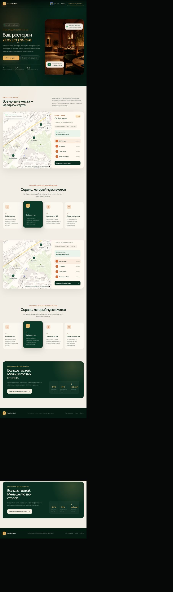
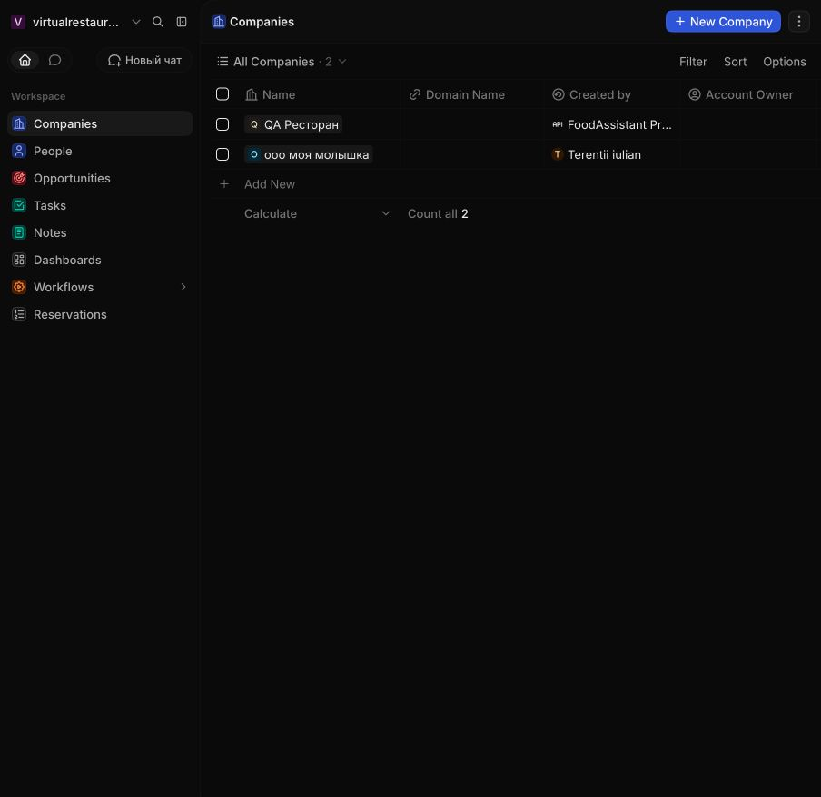
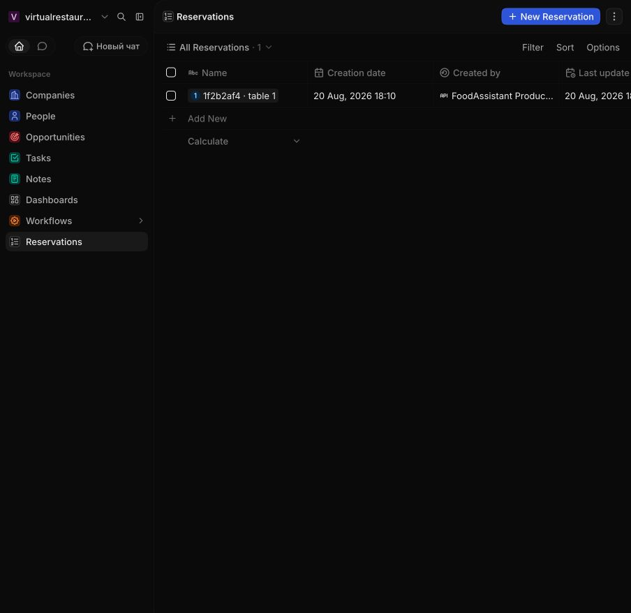
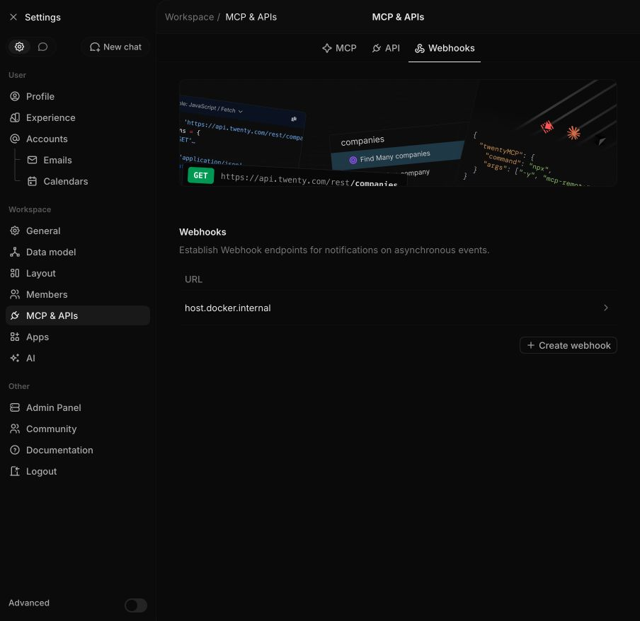

# Seatiko — code runbook

Код платформы: сайт, кабинет владельца, Android, API, модерация, CRM sync.

> **Сначала:** [`../README.md`](../README.md) (карта всего репозитория)  
> **Продуктовые правила:** [`../docs/README.md`](../docs/README.md)  
>   — профиль гостя / избранное / оплата / 18+: [`APP_LOGIC.md` §8](../docs/APP_LOGIC.md)  
> **Инженерия (Docker, API, production):** [`../docs/ENGINEERING.md`](../docs/ENGINEERING.md)

Этот файл — **практический runbook + скриншоты**. Не дублирует полный API/Docker guide: подробности в `docs/ENGINEERING.md`.

---

## Что работает

| Часть | Назначение | Адрес / путь |
|---|---|---|
| Публичный сайт | Презентация, карта (`map/places`), discover wizard | http://localhost/ · `/discover` · `/#map` |
| Кабинет владельца | Анкета, фото, статус, бронирования и история | http://localhost/cabinet |
| Гостевой web | Карточка ресторана и план столиков (`/venues/…`, `/book`) | http://localhost/ |
| Гостевой кабинет (web) | Профиль: имя, тема, избранное, аллергии, оплата, 18+ (UI / localStorage) | http://localhost/account |
| Админка | Модерация и публикация | http://localhost/admin |
| Android | Карта, рестораны, план зала и бронирование | `apps/mobile` |
| API | Пользователи, анкеты, рестораны, столики, брони и CRM sync | `../backend` (NestJS) |
| Twenty CRM | Владельцы, рестораны, гости, брони и Timeline | http://crm.localhost/ |

Сайт: RU / EN / RO (язык в браузере + кабинет).

> Примечание: в старых заметках встречался `/demo`. Актуальные гостевые сценарии на сайте — через карту, `/venues/[id]`, `/book`, `/discover`.

## TODO features (guest profile)

Local / UI-only in the current web guest cabinet — still to build on the backend:

- [ ] Favorites sync (API + DB; replace `localStorage`)
- [ ] Allergies / diet on `User` + `updateMe`
- [ ] Adult 18+ fields (`adult_preorder_allowed`, verifier metadata) + staff grant API
- [ ] Real payment methods / gateway (replace placeholders)
- [ ] Optional: follow `prefers-color-scheme` when the user has not chosen a theme

---

## Быстрый запуск

Из **корня репозитория** (не из этой папки):

```bash
docker compose up -d --build
docker compose ps
curl http://localhost/healthz
```

Данные API — Docker volume `api-data`, фото — `api-uploads`. Полный runbook: [`docs/ENGINEERING.md`](../docs/ENGINEERING.md).

### Android

```bash
cd seatiko/apps/mobile
flutter run --dart-define=API_URL=http://10.0.2.2
```

`10.0.2.2` — host machine из стандартного Android Emulator. Подробнее: [`apps/mobile/README.md`](apps/mobile/README.md).

---

## Архитектура (кратко)

```text
Сайт / Android / кабинет владельца
                 │
                 ▼
          Seatiko API
          │       │       │
          │       │       └── постоянный state + uploads
          │       └────────── история кабинета
          ▼
      CRM reconciler ───────────────► Twenty REST API
          ▲                              │
          └──── подписанный webhook ◄────┘
```

- Seatiko владеет аккаунтами, ролями, паролями, модерацией и публикацией.
- Twenty — CRM-проекция и Timeline.
- Правила sync и поля: [`TWENTY_CRM_INTEGRATION.md`](../docs/TWENTY_CRM_INTEGRATION.md) и раздел CRM в [`ENGINEERING.md`](../docs/ENGINEERING.md).

---

## Путь владельца ресторана (кратко + скриншоты)

Канон статусов и полей: [`RESTAURANT_OWNER_FLOW.md`](../docs/RESTAURANT_OWNER_FLOW.md).

1. http://localhost/register — аккаунт владельца → http://localhost/cabinet  
2. «Добавить ресторан»: название, описание, кухня, часы, адрес+точка на карте, телефон/email, сайт (опц.), цена, ≥1 фото  
3. Черновик сохраняется; перед фото текстовые поля уходят в API  
4. Отправка при готовности **7/7** → `DRAFT → SUBMITTED → UNDER_REVIEW → APPROVED → PUBLISHED` (или `REJECTED` с причиной)  
5. Статусы модерации/публикации меняет только Seatiko, не CRM  

---

## Карта и план столиков

Канон: [`MAP_ARCHITECTURE.md`](../docs/MAP_ARCHITECTURE.md).

- MapLibre + OpenFreeMap / OSM; точки из API  
- План зала: зелёный / жёлтый / красный / выбранный  




---

## Twenty CRM (скриншоты и локальные заметки)

Канон полей и webhook: [`TWENTY_CRM_INTEGRATION.md`](../docs/TWENTY_CRM_INTEGRATION.md), bootstrap — [`ENGINEERING.md`](../docs/ENGINEERING.md).

| Seatiko | Twenty | Ключ |
|---|---|---|
| Владелец или гость | People | `seatikoUserId` |
| Заявка/ресторан | Companies | `seatikoId` |
| Опубликованное заведение | Company `venueId` | Venue ID |
| Бронирование | Reservations | `seatikoReservationId` |





CRM может править безопасные поля Person/Company/рабочий статус брони; **не** пароли, роли, модерацию, публикацию. Входящие изменения → `CRM_PROFILE_UPDATED` в истории кабинета.

Seed-рестораны карты не уходят в CRM, пока нет заявки владельца.

### Секреты и webhook

Секреты — в корневом `.env` (см. [`ENGINEERING.md`](../docs/ENGINEERING.md#секреты-в-приватном-репозитории)). Шаблон: `.env.example`.

API сам готовит Twenty при первой синхронизации: поля Seatiko, объект Reservation, доску подключения ресторанов и дашборд. Отдельный шаг не нужен — достаточно `TWENTY_API_KEY` в `.env`.

Webhook: `http://host.docker.internal/api/v1/integrations/twenty/webhook`, secret = `TWENTY_WEBHOOK_SECRET`.



Локально compose может отключать Twenty outbound safe mode для Docker DNS; в production — HTTPS webhook и safe mode on.

### Контроль

```bash
curl http://localhost/healthz
curl http://localhost/api/v1/integrations/twenty/status
```

Ожидается `enabled: true`, `healthy: true`, `last_success_at`.

---

## Проверка перед демонстрацией

1. RU → EN → RO на сайте  
2. Карта на главной  
3. Выбор стола на плане (`/venues/…` или `/book`)  
4. `/cabinet` — 7/7, фото, статус, история  
5. CRM: Companies, People, Reservations и связи  
6. Изменить безопасное поле в CRM → увидеть в Seatiko; без дубля записи  
7. Перезапуск API → данные и логин на месте  

---

## Тесты

```bash
cd backend && npm run lint && npm test && npm run build
cd seatiko/apps/web && npm run lint && npm test && npm run build
cd seatiko/apps/mobile && flutter analyze && flutter test
```

Полный список: [`ENGINEERING.md` — Тестирование](../docs/ENGINEERING.md#тестирование).

---

## Безопасность

- Не класть секреты в `NEXT_PUBLIC_*`  
- После утечки ключа — ротация  
- Production: отдельная CRM-роль, HTTPS, сильный JWT, backup volumes / PostgreSQL  

Детали: [`ENGINEERING.md` — Безопасность и production](../docs/ENGINEERING.md#безопасность-и-production).
